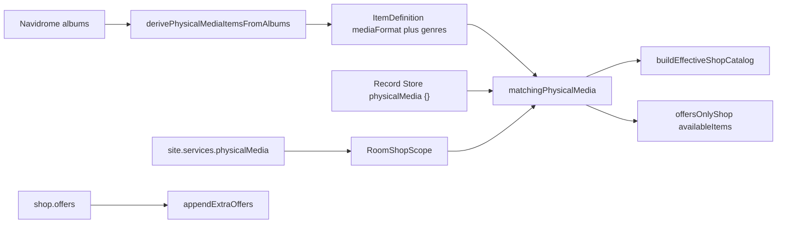

# Physical media carry

## Goal

A trip site should sell a chosen slice of the room's derived records (one or more genres, one or more formats) and can still list other goods. Trip shops are built for the trip: a site never opens a catalog shop from [`packages/plugin-item-shops/shops/`](packages/plugin-item-shops/shops/) any more, so nobody expects catalog shop hooks (Sweetwater follow-up calls, Green Room lost items) to run at a trip stop.

## Decisions

- **Sells physical media** lives on site `services`, next to gas and mechanic.
- **No `shopIds` on trips.** `site.shop` is composed only: `offers`, `sample`, `buybackRate`, `title`, `openingMessage`. Every site shop is the synthetic offers-only shop. `shopIds` also comes out of the `shopAccess` capability, since Road Trip is its only caller (`requestCapability` in [`plugin-road-trip/index.ts`](packages/plugin-road-trip/index.ts) is the only use outside tests).
- **Record Store stays a rotation shop** for non-trip rooms (all records, players, cleaners, broken media). It uses the same matcher with `physicalMedia: {}`.
- **The van is the playback device on a trip.** While a trip map is loaded, every traveler can play every format without holding a device. Site shops don't sell players, and the Record shop preset has no playback offers. Anything else (cleaners, merch) is an ordinary offer. **This isn't built yet** (see phase 5): the game-night plan designed it as `sharedPlaybackFormats` on Item Shops config (D42, M10), road-trip v1 cut it ("Van Tunes" in the cut table of [`plans/road-trip-v1/plan.md`](plans/road-trip-v1/plan.md)), and nothing in the code uses that name. Today, queueing a derived record without a matching held device fails with "You don't have anything to play this with." ([ADR 0160](docs/adrs/0160-playback-device-gating.md)).
- **Genres reach clients.** `ItemDefinition.genres` is not stripped; it isn't sensitive.
- **No Blank site preset.** `addBlankSite` already covers it (efee2229).
- **Future, not now:** a "shop effects" config on a site shop could bring back shop-style hooks if we ever want them.

## Assumptions

- Within formats, any selected format matches. Within genres, any selected genre matches. A record must pass both. Empty or omitted lists mean no limit on that axis, so the toggle alone carries every derived record.
- Genre match is trimmed and case-insensitive (`country` matches `Country`). No fuzzy match.
- A genre limit excludes records with no genre. Format-only and unfiltered bins still include them.
- Each traveler sees 3 distinct records from the bin (the existing per-visit catalog sample). Offers stay on the shelf in full, or are sampled on their own when `shop.sample` is set. The two samples are independent.
- `buybackRate` always applies to the site shop (default 0). The bin gets no special rate; the Record shop preset sets `0.1` to match Record Store.
- No `schemaVersion` bump and no migration. Trips haven't shipped and no maps exist outside this checkout, so `shopIds` is simply removed.

## Data model

Shared shape, Zod schema in [`packages/types`](packages/types/Inventory.ts) beside `PHYSICAL_MEDIA_FORMATS` (both `@repo/road-trip-map` and item-shops already depend on `@repo/types`; the map package must not import the plugin):

```ts
type PhysicalMediaCarry = {
  formats?: PhysicalMediaFormat[] // CD | LP | TAPE | 45; empty = all
  genres?: string[] // empty = all
}
```

- `ItemDefinition.genres?: string[]`: set when the album is derived.
- `TripSite.services.physicalMedia?: PhysicalMediaCarry`: present, even as `{}`, means the stop sells records.
- `ShopCatalogEntry.physicalMedia?: PhysicalMediaCarry`: omitted means the shop sells no derived records. Used by Record Store and the trip site shop. Code shops under `shops/` may opt in, but none do today.
- `OpenRoomShopRequest.physicalMedia`, `ValidateShopRequest.physicalMedia`, `RoomShopScope.physicalMedia`: the carry is stored as the filter, not as matched ids, so a late joiner's round re-matches against the current catalog.

Navidrome: Subsonic `genre` plus OpenSubsonic `genres[].name`, deduped, on `LibraryAlbumListItem`. Stale DJ Mac packs omit the field; those albums have no genres.

## Architecture



**Matcher.** [`packages/plugin-item-shops/localLibrary/physicalMediaStock.ts`](packages/plugin-item-shops/localLibrary/physicalMediaStock.ts): `matchingPhysicalMedia(entries, carry)` returns `{ shortId, coinValue }[]`. A record matches when its `mediaFormat` is allowed and, if `genres` is non-empty, one of its genres matches. Entries with no `mediaFormat` never match.

**Code shops.** [`buildEffectiveShopCatalog`](packages/plugin-item-shops/localLibrary/catalog.ts) stops special-casing Record Store. For every shop with `physicalMedia`, append matching derived shortIds to `availableItems`. Keep two existing behaviours:

- Record Store's playlist-scoped grant rows (`extraGrantStock`) stay in its stock. They are added with Record Store's fixed items, not through the matcher.
- Record Store is only listed when there are derived records. Any other shop with an empty bin is still listed with its own SKUs.

**Trip sites.** The site shop is always `offersOnlyShop(scope)`. When the scope has `physicalMedia`, the shop gets `distinctOffers: true` and the matched records as `availableItems`, so the normal catalog sample draws 3. `shop.offers` go through `appendExtraOffers` exactly as today. `resolveRoundAssignment` rebuilds the shop from the scope for late joiners.

`openRoomShop` returns `unavailable` when the bin is empty (or the room has no derived catalog) and no offer survives room gating. The van still parks with the existing warning. `validateShop` turns "no records match" and "no local library in this room" into warnings, never errors, so the same map loads in any room (ADR 0207).

**Studio.** Services in [`TripSiteInspector.tsx`](apps/game-studio/src/components/tripMap/TripSiteInspector.tsx): toggle, four format checks, genre chips (type a name, add, remove). Helper text: genres must match the album's Navidrome genre; tick the toggle with no format or genre to sell every record; other goods go under Shop. The catalog shop checkbox list goes away.

## In scope

- `genres` on album-derived records, from Navidrome.
- One carry filter and one matcher.
- Removing `shopIds` from trip maps, lint, presets, the sample map, Studio, studio-bridge's stub, and `shopAccess`.
- Site service `services.physicalMedia`, Studio controls, and a Record shop preset.
- The van as a playback device while a trip map is loaded.
- ADRs for the carry filter, the `shopIds` removal, and the van.

## Non-goals

- Changing how many records a visit shows (stays 3).
- A live genre list inside Game Studio.
- Filtering playlist-derived records by genre, except when a playlist replaces an album and inherits that album's genres.
- Removing the Record Store rotation shop, or changing rotation shop assignment for non-trip rooms.
- Shop effects / hooks on composed site shops.
- Converting catalog shops into composed site presets.

## Phases

### 1. Genres on derived records

Intent: albums carry Navidrome genres through the daemon, bridge row mapper, catalog API, and derivation onto `ItemDefinition.genres`. Shadowed playlists inherit them.

Files: [`apps/bridge-daemon/src/drivers/localTypes.ts`](apps/bridge-daemon/src/drivers/localTypes.ts), [`apps/bridge-daemon/src/drivers/local.ts`](apps/bridge-daemon/src/drivers/local.ts), [`packages/adapter-bridge/lib/localMetadata.ts`](packages/adapter-bridge/lib/localMetadata.ts), [`packages/types/Plugin.ts`](packages/types/Plugin.ts), [`packages/types/Inventory.ts`](packages/types/Inventory.ts), [`packages/plugin-item-shops/localLibrary/physicalMedia.ts`](packages/plugin-item-shops/localLibrary/physicalMedia.ts), [`packages/plugin-item-shops/localLibrary/index.ts`](packages/plugin-item-shops/localLibrary/index.ts) (copy the shadowed album's genres onto the playlist SKU where `albumRatingByPlaylistId` is built), plus the studio mock's `listLibraryAlbums` return type and fixtures. Give the mock albums a few genres so the trip simulator can show a genre bin.

Done means: album derivation tests show `genres` on the definition; a shadowed playlist inherits them; a row with no genre field still derives.

Depends on: none.

### 2. Shared carry filter and code shops

Intent: one matcher, one catalog merge. Record Store opts in with `{}`.

Files: new `physicalMediaStock.ts` and its test, [`catalog.ts`](packages/plugin-item-shops/localLibrary/catalog.ts), [`record-store.ts`](packages/plugin-item-shops/localLibrary/shops/record-store.ts), `ShopCatalogEntry` in [`packages/game-logic/src/shoppingSessionCatalog.ts`](packages/game-logic/src/shoppingSessionCatalog.ts) (re-exported as `ItemShopsShopCatalogEntry`).

Done means: a shop with `{ formats: ["CD"], genres: ["Country"] }` stocks only matching derived shortIds plus its own `availableItems`; a shop that omits the field stocks none of them; Record Store still stocks every derived record, fixed SKUs, and playlist grant rows, and is absent when there are no derived records. `npm test -w @repo/plugin-item-shops` covers this.

Depends on: phase 1.

### 3. Drop `shopIds` from trips and `shopAccess`

Intent: a site shop is composed only. Item Shops' room-shop path no longer resolves catalog shops for a scope.

Files:

- Map package: [`schema.ts`](packages/road-trip-map/src/schema.ts) (remove `shopIds`), [`lint.ts`](packages/road-trip-map/src/lint.ts) (drop the `unknown-shop` code and the "buyback rate with catalog shops" warning), [`presets.ts`](packages/road-trip-map/src/presets.ts) (delete `sitePresetForShop`), [`sampleMap.ts`](packages/road-trip-map/src/sampleMap.ts) (turn the Farmer's Market site into offers), `parseTripMap.test.ts`.
- Road Trip: `siteShopProblem` and `validateSiteShops` in [`index.ts`](packages/plugin-road-trip/index.ts), the has-a-shop check in [`trip/helpers.ts`](packages/plugin-road-trip/trip/helpers.ts), `index.test.ts`.
- Capability: `OpenRoomShopRequest`, `ValidateShopRequest` and the `unknown-shop` reason in [`Capabilities.ts`](packages/types/Capabilities.ts); `RoomShopScope`, `validateRoomShopIds`, `UNAVAILABLE_NOTES` and `validateRoomShopRequest` in [`roomShop.ts`](packages/plugin-item-shops/roomShop.ts); `resolveScopedShops` and the scoped-shop branches of `openRoomShop`, `validateRoomShop` and `resolveRoundAssignment` in [`plugin-item-shops/index.ts`](packages/plugin-item-shops/index.ts); `autoShop.test.ts`, [`PluginRegistry.capabilities.test.ts`](packages/server/lib/plugins/PluginRegistry.capabilities.test.ts).
- Studio: `SHOP_OPTIONS`, `KNOWN_SHOP_IDS`, `EVERYWHERE_SHOP_IDS`, the per-shop entries in `SITE_LIBRARY`, and `validateCatalogShop`'s shop branch in [`tripMapDraft.ts`](apps/game-studio/src/tripMap/tripMapDraft.ts); the shop checkbox list in [`TripSiteInspector.tsx`](apps/game-studio/src/components/tripMap/TripSiteInspector.tsx); [`stubRoadTrip.ts`](apps/studio-bridge/src/stubRoadTrip.ts).
- Docs: [`apps/game-studio/README.md`](apps/game-studio/README.md), [`docs/PLUGIN_DEVELOPMENT.md`](docs/PLUGIN_DEVELOPMENT.md) wherever they describe catalog shops on sites.

Done means: `rg shopIds packages/road-trip-map packages/plugin-road-trip apps/game-studio apps/studio-bridge packages/types/Capabilities.ts` finds nothing; offers-only sites open and validate as before. Typecheck plus road-trip-map, plugin-road-trip and item-shops tests pass.

Depends on: none. Can run alongside phases 1–2.

### 4. Trip site service and shop open

Intent: `services.physicalMedia` is valid map JSON and is enough to open a stop's shop. Offers still append.

Files: [`Capabilities.ts`](packages/types/Capabilities.ts) (`physicalMedia` on both requests), [`schema.ts`](packages/road-trip-map/src/schema.ts) (`services.physicalMedia`), [`lint.ts`](packages/road-trip-map/src/lint.ts) (pass the carry to `validateShop`), [`roomShop.ts`](packages/plugin-item-shops/roomShop.ts) (`RoomShopScope.physicalMedia`, `offersOnlyShop` takes the matched bin), [`plugin-item-shops/index.ts`](packages/plugin-item-shops/index.ts) (`openRoomShop`, `validateRoomShop`, `resolveRoundAssignment`), [`plugin-road-trip/index.ts`](packages/plugin-road-trip/index.ts) and [`trip/helpers.ts`](packages/plugin-road-trip/trip/helpers.ts) (a stop with only the service has a shop), parse/lint tests.

Done means: a site with only `services: { physicalMedia: { formats: ["CD"], genres: ["Country"] } }` validates and opens a 3-offer bin of matching records; a late joiner gets a bin from the same filter; adding `shop.offers` appends them, sampled on their own when `shop.sample` is set; a bridge room with no matches, or a non-bridge room, warns and still loads the map, and the stop parks.

Depends on: phases 2 and 3.

### 5. The van as playback device

Intent: while a trip map is loaded, queue gating treats the van's formats as playable. The map sets them in `tuning.vanPlayback: { formats, gentle }`; `formats` defaults to all four and `gentle` to `false`. Owning the record is still required. Records wear as usual unless `gentle` is true, which makes the van work like a hi-fi device ([ADR 0166](docs/adrs/0166-hifi-playback-devices-skip-wear.md)).

Design: Item Shops owns gating, so Road Trip tells it. Add `setSharedPlayback(ownerId, { formats, gentle })` to `shopAccess`; an empty `formats` list clears that owner. Item Shops keeps one entry per owner in plugin storage. It unions every entry's formats into `playableFormats(items)` at the single server-side check in `validateQueueRequest` ([`localLibrary/index.ts`](packages/plugin-item-shops/localLibrary/index.ts), around line 723), and the formats of entries with `gentle: true` into `gentlePlayableFormats(inv.items)` in `wearRecordForQueue`. Road Trip calls it with `resolveTripTuning(map).vanPlayback` when a map loads, and with `[]` when it unloads. A held hi-fi device still skips wear even when the van doesn't. "Map loaded" is trip mode (ADR 0205, D2), so this matches "during trips" without tracking departure. Room scoping comes from the plugin storage already being per room.

Head starts for loadouts (see "Future: trip loadouts"):

- `vanPlayback` is one object, so a loadout can override it as a unit.
- Add `resolveTripTuning(map)` to [`derive.ts`](packages/road-trip-map/src/derive.ts) beside `resolveSiteSettings`. It returns the effective tuning, which today is `map.tuning` unchanged. Road Trip reads `vanPlayback` only through it. Later it takes the chosen loadout too; other `map.tuning` and `map.route` reads move onto it then, not in this plan.

Files: [`schema.ts`](packages/road-trip-map/src/schema.ts) (`tripTuningSchema.vanPlayback`: `formats` an array of `PHYSICAL_MEDIA_FORMATS` defaulting to all four, `gentle` defaulting to `false`), [`derive.ts`](packages/road-trip-map/src/derive.ts) (`resolveTripTuning`), [`lint.ts`](packages/road-trip-map/src/lint.ts) (warn when a site's `physicalMedia.formats` includes a format the van can't play; an empty `formats` on the site means "every format", so it warns only when the van doesn't play all four), Studio's trip settings in [`TripMapEditor.tsx`](apps/game-studio/src/components/tripMap/TripMapEditor.tsx) (four "Van plays" format checks and a "Van plays records without wear" checkbox), [`Capabilities.ts`](packages/types/Capabilities.ts), [`plugin-item-shops/index.ts`](packages/plugin-item-shops/index.ts) (capability method, storage key), [`localLibrary/index.ts`](packages/plugin-item-shops/localLibrary/index.ts), [`localLibrary/playbackDevices.ts`](packages/plugin-item-shops/localLibrary/playbackDevices.ts) (take shared and shared-gentle formats), [`plugin-road-trip/index.ts`](packages/plugin-road-trip/index.ts) (set on load, clear on unload and in `onConfigChange` when disabled, re-assert on start when a map is already loaded), [`stubRoadTrip.ts`](apps/studio-bridge/src/stubRoadTrip.ts) if the simulator queues records, tests.

Done means: with a trip map loaded, a user holding a CD and no device can queue it, and the CD wears as usual; with `vanPlayback.gentle: true` it doesn't wear; with `vanPlayback.formats: ["CD"]` an LP still fails; after unload the same queue fails with the ADR 0160 message; a user with no copy of the record still can't queue it; two owners' formats union, and clearing one leaves the other; the Studio controls write `tuning.vanPlayback`; a CD-only van with an LP bin gets the lint warning.

Depends on: none. Can run alongside phases 1–4.

### 6. Studio authoring

Intent: Services toggle, format checks, genre chips, Record shop preset. No catalog shop picker.

Files: [`presets.ts`](packages/road-trip-map/src/presets.ts) (Record shop in `GENERIC_SITE_PRESETS`: icon 📀, `services.physicalMedia: {}`, `shop.buybackRate: 0.1`, no offers; with no item-shops ids it can live in the map package), [`tripMapDraft.ts`](apps/game-studio/src/tripMap/tripMapDraft.ts), [`TripSiteInspector.tsx`](apps/game-studio/src/components/tripMap/TripSiteInspector.tsx), studio-bridge so the trip simulator opens a bin at a records stop.

Done means: adding a Record shop site, narrowing it to Country and CDs, and adding another offer writes `services.physicalMedia` plus `shop.offers` and no `shopIds`. Verify in the Game Studio browser: services toggle, chips, offer picker, no shop checkbox list, and a simulated visit to the stop.

Depends on: phase 4.

### 7. ADR

Intent: record why carry lives on services and shop entries, why trips stopped naming catalog shops, and how the van counts as a playback device.

Files: `docs/adrs/0214-physical-media-carry.md`, `docs/adrs/0215-van-shared-playback-formats.md` (amends [0160](docs/adrs/0160-playback-device-gating.md): devices are no longer the only source of playable formats), [`docs/adrs/index.md`](docs/adrs/index.md); set [0206](docs/adrs/0206-declared-plugin-capabilities.md) and [0207](docs/adrs/0207-trip-maps-portable-json.md) to "Partially superseded by [0214]" with a short note on what changed (`shopIds` on `shopAccess`; the catalog shop picker and per-shop site presets).

Done means: index lists 0214 and 0215 as Accepted, 0206 and 0207 show the partial supersede, and 0160 notes the amendment.

Depends on: none. Write 0214 with phase 4 and 0215 with phase 5 so each decision matches the code.

## Future: trip loadouts

Not in this plan. A loadout is a preset the room picks before departure (e.g. a 1999 Chevy Astro or a 2023 Ford Transit) that carries trip config. How the effects we've talked about fit what this plan leaves behind:

| Effect                   | Fits today | Notes                                                                                                                                                                                            |
| ------------------------ | ---------- | ------------------------------------------------------------------------------------------------------------------------------------------------------------------------------------------------ |
| Fuel efficiency          | Yes        | Model it as an `mpg` factor, like van parts in [`van.ts`](packages/road-trip-map/src/van.ts), so the author's `route.tanksPerTrip` stays the difficulty setting. An absolute MPG would fight it. |
| Top speed                | Yes        | A `speed` factor, same as parts.                                                                                                                                                                 |
| Physical media formats   | Yes        | Override `tuning.vanPlayback` through `resolveTripTuning`, and call `setSharedPlayback` again when the van is chosen.                                                                            |
| Per-user inventory slots | No         | Slot caps are session-wide in `GameSessionConfig` (`maxInventorySlots` and friends), set by admins. There's no per-user bonus or plugin API for it. This needs core work.                        |

## Risks

- Genre strings are only as good as Navidrome tags. Studio can't tell the author the library has no "Country". The stop warns when the bin is empty.
- Old DJ Mac packs omit genres, so a genre-limited site sells nothing until the pack is updated. Format-only bins still work.
- Shared formats live in Item Shops storage, so they can outlive Road Trip's state. Road Trip clears them in `onConfigChange` when it is disabled, re-asserts them on start when a map is loaded, and clears on unload. If Item Shops is disabled and re-enabled mid-trip, the entry is still in storage.
- Players still sold by the Record Store rotation shop are redundant during a trip. That's fine; trip stops don't sell them.
- Authors lose the one-click catalog shop stands. The offer picker still lists every catalog item, so a trip-themed stand is a few picks away, but without that shop's hooks.
