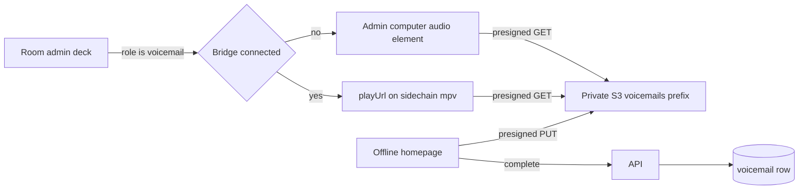

# Show voicemail

## Goal

People can leave a voicemail from the homepage while the station is off the air, without an account and without a phone number. During a show, a scheduler segment called out as voicemails gives the room admin a list of messages for a time range they choose. The admin chooses what plays. Nothing auto-airs. Sound comes out of the DJ Mac when the bridge is connected, on the same CoreAudio device as TTS so Audio Hijack ducks the bed, and out of the admin's computer when it is not.

## Stack and conventions

Express + Socket.IO in `packages/server`, Postgres via Drizzle (`packages/db`), Redis for ephemeral coordination ([ADR 0003](docs/adrs/0003-redis-for-ephemeral-room-data.md)). The public home is [`apps/web/src/components/Lobby/Lobby.tsx`](apps/web/src/components/Lobby/Lobby.tsx): off-air is `!room && isReady` (no public room), which is the same condition as today's "Listening Room is offline" copy. Room admin is `useIsAdmin`, not the platform Better Auth role. Segments are one table with no kind enum ([`packages/db/src/schema/scheduling.ts`](packages/db/src/schema/scheduling.ts)); activation is `SET_ACTIVE_SEGMENT` → [`activateRoomSegment`](packages/server/operations/activateRoomSegment.ts). Private uploads already use presigned S3 PUT under a prefix CloudFront cannot read ([ADR 0119](docs/adrs/0119-private-music-uploads-presign.md), lifecycle in [`infra/cdn/main.tf`](infra/cdn/main.tf)). Bridge playback is a `BridgeRequest` method list in [`packages/adapter-bridge/lib/protocol.ts`](packages/adapter-bridge/lib/protocol.ts). mpv already `loadfile`s HTTPS URLs for Navidrome; there is no method for an arbitrary URL. The `/device` socket ([ADR 0204](docs/adrs/0204-device-trust-boundary.md), accepted) is the current daemon's only RPC transport ([`deviceClient.ts`](apps/bridge-daemon/src/deviceClient.ts)); the API still falls back to Redis RPC for old packs. Both carry the same `BridgeRequest` method names, so a new method rides both wires. A daemon that does not know a method drops the request at `bridgeRequestSchema.safeParse` and sends no response, so the API sees a timeout after `BRIDGE_RPC_TIMEOUT_MS` (8s), not an error.

## Assumptions

- Off-air means no public lobby room, the condition the homepage already uses.
- One station-wide inbox. Any room admin, in any room, queries it by time range while a voicemail segment is active. The deck opens on the previous 30 days; that window is a default, not the API.
- The admin list is the vetting step. Messages are not reviewed before they appear there, and nothing plays until an admin presses play. A hide action removes junk from the list.
- Callers are anonymous. An optional display label (max 40 characters) is stored; no `userId`, username, or IP is stored on the row. Empty label shows as "Anonymous" and is never published as Now Playing.
- "Scrub like any other audio" means a playhead on the voicemail deck, not the room Now Playing scrubber. `SEEK_PLAYBACK` seeks the active queue source (often Spotify) and an `ENDED` from that source advances the queue ([`bridgeAdvance.ts`](packages/adapter-bridge/lib/bridgeAdvance.ts)). The URL channel must not do either.
- Programme audio keeps playing. A voicemail always uses `tts.audioDevice`, the sidechain Audio Hijack already ducks ([ADR 0178](docs/adrs/0178-media-bridge-tts-say-output.md), Loopback **Ducking** in [ADR 0109](docs/adrs/0109-local-remote-loopback-sidechain-ducking.md)). It does not pause Spotify, library mpv, or YouTube. A future plugin caller of `playUrl` would use that same device with `duck: true`, and a second mpv on the default output with `duck: false`.
- Non-bridge playback is the admin machine's speakers (their broadcast mix). Other listeners' browsers do not play the file. That path has no Audio Hijack duck.

## In scope

- Homepage recorder, max 2:00, presigned PUT, rate limit, thank-you state.
- Postgres `voicemail` rows and a segment `role` of `standard` | `voicemail`.
- Scheduler control to mark a segment as voicemails.
- Admin deck while that segment is active: list, play, pause, scrub, hide.
- A generic bridge URL channel: `playUrl` with `duck: true` loads an mpv on `tts.audioDevice`; `duck: false` loads a second mpv on the default output. Pause, resume, seek, and position for the deck reuse `pause` / `play` / `seekTo` / `getPlayback` with `source: "url"` and apply only to the ducking player. The voicemail deck always passes `duck: true` and `mode: "replace"`.
- ADR 0214.

## Non-goals

- Keeping the Quicktalk phone number in the UI. The `tel:` link in `Lobby.tsx` comes out. `VITE_VOICEMAIL_NUMBER` can leave the deploy env after this ships.
- Auto-play, a moderation queue before the admin list, transcription, or caller accounts.
- Putting voicemails on the public CDN, in the music queue, or in Now Playing metadata.
- A voicemail plugin, and any plugin-facing bridge playback API. `queueSoundEffect` is unchanged. When a plugin needs bridge audio, add it on `context.playback` beside bridge TTS (ADR 0201), not on `context.api`.
- Pausing or resuming the programme when a message starts or ends. The bed keeps playing; Audio Hijack ducks it.
- Merging with the device-trust plan. The new RPC method is enough for both the current Redis RPC and the `/device` socket.

## Architecture

Rejected: matching a segment titled "Voicemails" (a rename would break the room). Rejected: reusing the music-upload persona flow (it requires a room login and writes the username into the S3 key). Rejected: a public `media/` URL (a leaked link would be permanently readable).

## Data model

New table `voicemail` in `packages/db`:

- `id` text pk (`createId`)
- `createdAt` timestamp
- `s3Key` text
- `contentType` text (`audio/webm`, `audio/mp4`, or `audio/ogg`)
- `byteSize` integer
- `durationMs` integer (client-reported, 1..120000; the player uses the file's real duration once loaded)
- `label` text null
- `status` enum `ready` | `hidden`

No uploader column. Index `createdAt`. S3 key `voicemails/v1/{id}.{ext}`, not on the CloudFront allowlist. Lifecycle rule beside `uploads/` in [`infra/cdn/main.tf`](infra/cdn/main.tf): expire `voicemails/` after 120 days. The API's IAM user (`aws_iam_user_policy.sender_s3_put`) has `s3:PutObject` on the bucket but `s3:GetObject` only on `media/*`. Add `s3:GetObject` on `voicemails/*`: `HeadObject` authorizes as `GetObject`, and a presigned GET signed by a user without it returns 403. The list refuses a `from` older than that, so the deck never offers a file the lifecycle has deleted. Rows can remain in Postgres after the object is gone; they simply fall outside the query.

`segment.role` text or pg enum, not null, default `standard`. Only `voicemail` changes room behavior.

Redis, not the row: rate-limit counters, and a short-lived presign session `{ uploadId, key, contentType, contentLength, durationMs, label }` TTL 2 hours, same shape as music-upload sessions but with no `userId`.

## API contract

Public, no session header:

- `POST /api/voicemails/presign` body `{ contentType, contentLength, durationMs, label? }`. Rejects duration outside 1..120000, content length above 4MB, or a MIME outside `audio/webm`, `audio/mp4`, `audio/ogg`. Returns `{ uploadId, url }` and the signed headers. Does not return a GET URL.
- `POST /api/voicemails/complete` body `{ uploadId }`. `HeadObject` must exist and match size and type. Then insert `status: ready`. Response `{ ok: true }` only.

Rate limit in Redis, keyed by an HMAC-SHA256 of the client IP with a server secret (new env `VOICEMAIL_IP_HMAC_SECRET`). A plain hash is not enough: there are only about 4 billion IPv4 addresses, so an unkeyed hash can be reversed by brute force. Each counter's TTL matches its own window:

- 10 presigns per IP per hour (TTL 1 hour)
- 3 completed voicemails per IP per 24 hours (TTL 24 hours)

Presign also reads the completed counter and rejects when it is already at 3, so a caller over the daily limit learns that before recording and uploading. Complete checks and increments it again, because the presign check alone can be raced.

Room-admin socket events, answered on the requesting socket only (not a room broadcast, not a SystemEvent). "Ack" below means a `socket.emit("event", { type, data })` back to that socket, the pattern in [`adminHandlersAdapter.ts`](packages/server/handlers/adminHandlersAdapter.ts), not a Socket.IO ack callback:

- `LIST_VOICEMAILS` `{ from, to }` → `ready` rows with `createdAt >= from` and `createdAt < to`, newest first, cap 200. Each item has `id`, `createdAt`, `durationMs`, `label`, and a presigned GET (4 hours). The ack includes the applied `{ from, to }` and `truncated: true` when the cap cut the page. `from` and `to` are ISO timestamps. Reject when `from >= to`, when the span is over 45 days, or when `from` is older than the 120-day retention. This stays a room-admin socket event, not a public REST route, because the payload carries presigned GET URLs.
- `PLAY_VOICEMAIL` `{ id }` → the handler mints a presigned GET and calls bridge `playUrl`. It does not pause the room playback controller. The file and the bed mix in Audio Hijack, which ducks the bed from that sidechain input.
- `PAUSE_VOICEMAIL`, `SEEK_VOICEMAIL` `{ positionMs }`, `GET_VOICEMAIL_PLAYBACK` → bridge `pause` / `seekTo` / `getPlayback` with `source: "url"`. These socket names stay voicemail-scoped because they are the admin deck, not a general "play any URL" control.
- `HIDE_VOICEMAIL` `{ id }` → `status: hidden`.

`LIST_VOICEMAILS` is allowed only when the room's active segment role is `voicemail` and the socket is a room admin. If the daemon RPC fails (old pack, no method), the ack says so and the deck falls back to the `<audio>` element using the same presigned GET.

## UX

Homepage, only in the existing offline branch of `LobbyContent`: a "Leave a voicemail" control. Record with `MediaRecorder` (`audio/webm;codecs=opus`, else `audio/mp4`, else `audio/ogg`) and `audioBitsPerSecond: 96000`, so a 2:00 recording stays near 1.5MB in every browser rather than close to the 4MB cap (Safari's default AAC bitrate can approach it). Hard-stop at 2:00 with a visible countdown. When the recording is WebM, rewrite its header in the browser before preview and upload so it carries a duration and cues (for example with `ts-ebml`), and upload the patched blob. MP4 and Ogg upload as recorded. Preview the blob, optional label, then upload. Unsupported browsers get a short "this browser can't record" line. Success replaces the control with a thank-you until reload. The recorder is absent whenever a public room is in the lobby.

Scheduler: role field on create ([`CreateSegmentModal.tsx`](apps/scheduler/src/components/segments/CreateSegmentModal.tsx)) and on the segment detail editor. Default Standard. One segment set to Voicemails is placed on a show like any other segment. No migration seed row.

Room: while `activeSegmentRole === "voicemail"` and `useIsAdmin`, a deck in the admin schedule area ([`RoomSchedulePanel.tsx`](apps/web/src/components/RoomSchedulePanel.tsx) or the sidebar next to it). Two datetime fields default to 30 days ago through now; changing either refetches `LIST_VOICEMAILS`. Rows show relative time, duration, and label. Play, pause, and a range scrubber. Hide. Bridge connected: scrubber follows `GET_VOICEMAIL_PLAYBACK`. Bridge down or RPC missing: one `<audio>` element, `src` the presigned GET, native or the same range control. Listeners do not see the deck.

`activateRoomSegment` writes `activeSegmentRole` onto the Redis room next to `activeSegmentId`, reading `role` from the `SegmentDTO` that `findShowById` returns (so `role` must be on that DTO and its query mapping). [`AdminService.ts`](packages/server/services/AdminService.ts) has two clear paths, and both must drop it: detaching the show (`showId: null`, which deletes `activeSegmentId` from the settings object and adds it to `hDelRoomDetailsFields`) and clearing the segment alone (`activeSegmentId: null`). The client reads it from room settings. Do not put the caller label on `SEGMENT_ACTIVATED` or Now Playing.

## State management

Lobby recorder is local React state in a new component. No XState machine: it is a one-shot form with no socket stream. The deck can be local state plus socket request/response from the admin handlers; it does not need a room-wide actor. Bridge connected stays `useMediaBridgeConnected()`.

## Security

- Presign and complete are unauthenticated. The only abuse bound is the IP rate limit plus the 4MB / 2 minute caps.
- GET URLs are minted only inside admin socket handlers. `playUrl` accepts `https` URLs only, so the daemon will not fetch `file:` or `http:`.
- Label is trimmed, control characters stripped, 40 characters max.
- IP is used only as the HMAC input for the Redis counters. Neither the raw IP nor its HMAC is written beside the message.
- `HeadObject` on complete, unlike music upload, because this endpoint is public.

## Implementation phases

### 1. ADR and schema

Record ADR 0214 (private voicemail objects, segment role, a generic bridge URL sidechain that ducks the bed and does not advance the queue) and add it to [`docs/adrs/index.md`](docs/adrs/index.md). Add `voicemail` and `segment.role` in `packages/db`, generate the next drizzle migration, and add types in `packages/types`.

Files: `docs/adrs/0214-show-voicemail.md`, `docs/adrs/index.md`, `packages/db/src/schema/scheduling.ts`, new voicemail schema, `packages/types/Scheduling.ts`, new `packages/types/Voicemail.ts`.

Done means: migration SQL exists, `role` defaults to `standard`, types export the row and the two roles.

Depends on: nothing.

### 2. Public upload API

`VoicemailService` (presign, complete, list, hide, presigned GET) and public routes on the API router next to the music-upload mounts in [`packages/server/index.ts`](packages/server/index.ts). Reuse the S3 presign helper music upload uses (`packages/server` presign module). Rate-limit helper with Redis `INCR` + `EXPIRE`.

Files: `packages/server/services/VoicemailService.ts`, `packages/server/controllers/voicemailController.ts`, `packages/server/index.ts`, tests beside the controller.

Done means: a test presigns, a second complete inserts a row only after a mocked head matches, a fourth complete within the window is rejected, a presign is rejected once three completes are already counted, the counter keys are HMACs and not the raw IP, the presign counter expires after an hour and the completed counter after 24 hours, and a public response never includes a GET URL.

Depends on: phase 1.

### 3. Homepage recorder

New `VoicemailRecorder` used by the offline branch of [`Lobby.tsx`](apps/web/src/components/Lobby/Lobby.tsx). Remove the `tel:` clause. Client helpers in [`apps/web/src/lib/serverApi.ts`](apps/web/src/lib/serverApi.ts) for presign and complete. PUT the blob to the signed URL, then complete.

Done means: with no public room, the homepage shows the recorder and not the phone link; with a public room, neither the recorder nor the phone link shows. API tests from phase 2 still pass. Browser check of the offline lobby (recording itself needs a microphone; if the tool browser has none, confirm the control renders and say the capture could not be exercised).

Depends on: phase 2.

### 4. Segment role through activation

Persist `role` on create and update in the scheduling service and router. Scheduler form field. `activateRoomSegment` copies `role` to `activeSegmentRole` on the room; schedule clear removes it. Extend the room type and the settings snapshot the web client already stores.

Files: scheduling service + [`packages/server/routes/schedulingRouter.ts`](packages/server/routes/schedulingRouter.ts), [`CreateSegmentModal.tsx`](apps/scheduler/src/components/segments/CreateSegmentModal.tsx) and [`SegmentDetailDrawer.tsx`](apps/scheduler/src/components/segments/SegmentDetailDrawer.tsx), [`activateRoomSegment.ts`](packages/server/operations/activateRoomSegment.ts), [`AdminService.ts`](packages/server/services/AdminService.ts), [`packages/types/Room.ts`](packages/types/Room.ts), and the web app's own copy in [`apps/web/src/types/Room.ts`](apps/web/src/types/Room.ts) plus [`settingsMachine.ts`](apps/web/src/machines/settingsMachine.ts), which already carries `activeSegmentId`.

Done means: creating a segment with role `voicemail` and activating it sets `activeSegmentRole` on the room; activating a standard segment sets `standard`; clearing the show removes it.

Depends on: phase 1. Can land in parallel with phases 2–3.

### 5. Admin deck, browser playback

Admin-only socket handlers in [`packages/server/controllers/adminController.ts`](packages/server/controllers/adminController.ts). Deck UI for admins when the role is `voicemail`. This phase always plays through an `<audio>` element on the admin's machine. Hide calls `HIDE_VOICEMAIL`.

Done means: the deck opens on the previous 30 days and refetches when either datetime changes; a service test returns only rows inside `{ from, to }` and rejects an inverted range, a span over 45 days, and a `from` older than 120 days; an admin can play, scrub, and hide one in the browser; a non-admin does not receive the list; a hidden row disappears from the next list.

Depends on: phases 2 and 4.

### 6. URL sidechain on the DJ Mac

Add one bridge method, `playUrl`, with params `{ url, mode, duck }`. `mode` is `"replace"` or `"enqueue"`. `duck` is boolean. Transport for the ducking player reuses `pause`, `play`, `seekTo`, `stop`, and `getPlayback` with `source: "url"`. Do not add voicemail-named RPC methods, and do not add `url` to `bridgeSourceSchema`: [`Router.playTrack`](apps/bridge-daemon/src/router.ts) pauses `this.active` when the source changes, and a URL load must not do that. Because the URL players are not in the driver map, [`RpcServer.dispatch`](apps/bridge-daemon/src/rpcServer.ts) must branch on `source === "url"` for `play`, `pause`, `stop`, `seekTo`, and `getPlayback` before it calls the Router. Router looks the source up in `drivers` and silently does nothing (or returns `UNOBSERVED` for `getPlayback`) when it is missing, so without that branch every transport call would succeed and do nothing. An old pack behaves exactly that way for `source: "url"`, so the deck treats `observed: false` as "no URL player" and falls back to `<audio>`.

Daemon: two `UrlPlayback` instances, each cloned from [`MpvPlayback`](apps/bridge-daemon/src/drivers/localPlayback.ts), neither registered in the Router driver map. The ducking one uses IPC socket `mpv-url.sock` and `--audio-device` set to `tts.audioDevice` from [`apps/bridge-daemon/src/config.ts`](apps/bridge-daemon/src/config.ts). That is the device ADR 0178 already sends Burner Phone TTS to, which Audio Hijack routes as the sidechain into the Loopback Ducking device. The dry one uses `mpv-url-dry.sock` and no `--audio-device`, so it follows the default output the way library mpv does and does not enter the sidechain. Both use `--no-video` and `--keep-open=always`. Do not reuse library mpv's socket, and do not use the TTS one-shot player in [`tts.ts`](apps/bridge-daemon/src/tts.ts). Reject anything other than `https`. If `tts.audioDevice` is unset, a `duck: true` RPC fails closed the way `speak` does, and the deck uses the phase 5 `<audio>` path. A `duck: false` RPC still plays on the default output.

`replace` clears the pending list of the player `duck` selected and `loadfile`s now. It does not clear the other player. The admin deck uses `duck: true` and `mode: "replace"`, so a chosen voicemail starts on the sidechain immediately. `enqueue` appends to that player's list, capped at 8 per player. Each player starts its next URL from its own mpv end-file handler. `stop` with `source: "url"` clears the ducking player only. The RPC returns once the file is loaded or appended, not when it finishes.

[`capability.ts`](packages/adapter-bridge/lib/capability.ts) stores the latest `STATE` and `ENDED` as the programme's last state, so neither player publishes those events. The deck learns position from `getPlayback` `{ source: "url" }` on the ducking player only. `PLAY_VOICEMAIL` mints the presigned GET, calls `playUrl` with `mode: "replace"` and `duck: true`, and does not pause the playback controller.

TTS and a ducked URL can overlap on the sidechain device. A dry URL mixes with programme audio on the default output. Do not `pkill mpv`.

Files: [`protocol.ts`](packages/adapter-bridge/lib/protocol.ts), [`apps/bridge-daemon/src/rpcServer.ts`](apps/bridge-daemon/src/rpcServer.ts), new playback class started from [`apps/bridge-daemon/src/index.ts`](apps/bridge-daemon/src/index.ts), admin play handler, deck.

Done means: a bridge test `playUrl`s an `https` URL with `duck: true` and `mode: "replace"` and seeks it with `source: "url"`, on the TTS device; a `duck: false` enqueue uses the dry player and does not clear the ducked file; a ninth enqueue on one player is rejected while the other player still accepts; programme `pause` is not called; no `STATE` or `ENDED` is published for either player; a non-https URL is rejected; an unset `tts.audioDevice` fails only the ducked RPC, and the deck then plays on the admin machine. Shipping to a real show requires a new DJ Mac pack (`npm run pack:dj-mac`) and a TTS device already selected in the local-remote bridge form. No new device picker.

Depends on: phase 5.

## Risks and tradeoffs

- IP rate limits are shared by NAT and bypassed by rotating IPs. The cap is a cost and spam brake, not identity. The 4MB ceiling bounds a burst.
- Neither URL mpv is in the driver map, so an end cannot advance the queue or replace programme `lastState`. The ducked player only ducks the bed when `tts.audioDevice` is the source Audio Hijack already feeds to the sidechain. The dry player uses the default output, so it mixes with the bed and does not duck it.
- Two URL players, each with its own queue of 8. `replace` clears only the player it targets. TTS still mixes with ducked URLs on the sidechain device. A dry URL does not wait behind a voicemail.
- Old DJ Mac packs keep working for music. Voicemail falls back to the admin's speakers until the pack is updated, and until `tts.audioDevice` is set.
- Client-reported duration can lie. The size cap and the player's real duration are the bounds; no ffprobe in v1.
- Chrome's `MediaRecorder` WebM has no duration and no cues. In a browser `<audio>` element, `duration` reads `Infinity` until the file has played through, and seeking is unreliable. mpv also seeks poorly in a cue-less WebM. "The player uses the file's real duration once loaded" does not hold for the most common caller browser, which is why the recorder patches WebM duration and cues in the browser before upload (UX section). A file that skips the patch, such as a hand-crafted upload, can still be unseekable; the size and duration caps bound that.
- The presign must store and sign the base MIME (`audio/webm`), not the recorder's `audio/webm;codecs=opus`, and the client must PUT with exactly that `Content-Type`, or S3 rejects the signature and `HeadObject` will not match.
- mpv with `--keep-open=always` may not emit `end-file` at a natural EOF (it can pause on the last frame and set `eof-reached` instead). Confirm how library mpv actually ends today before relying on `end-file` to start a queued URL; observing `eof-reached` may be needed.
- Ducking depth and release stay whatever Audio Hijack / the local-remote compressor already do ([ADR 0109](docs/adrs/0109-local-remote-loopback-sidechain-ducking.md)). This feature does not retune them.

## Open questions

None. Resolved in review (2026-10-19):

- WebM duration and seeking: patch the header in the browser before upload. No ffmpeg on the API.
- Plugin bridge output: dropped from this work. `playUrl` still ships with `enqueue` and `duck: false`, and a future plugin API goes on `context.playback`.
- Inbox access: any room admin, only while a voicemail segment is active in that room.
- Off-air: no public lobby room. A show in a non-public room does not hide the recorder.
