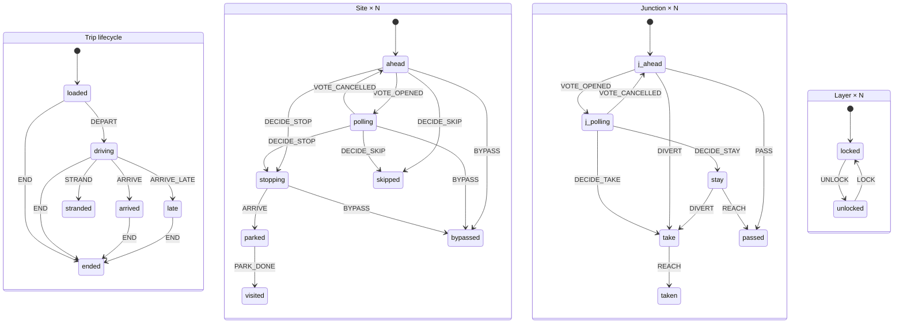

# Trip branches: layers, routes, choices

## Context

A trip map is one line today. `route` is a scalar (`driveMinutes`, `baseMph`), and every site and event has one `mile` between 0 and `routeMiles`. Throughout the engine, "ahead" means a plain mile comparison against the ledger's odometer: `sortedSites`, `nearestMechanicAhead`, `milesToNextGas`, `parkPlan`, `skipDefaultsAhead`, thresholds, `towPast`, and the projection. State changes are spread out too. Site phases are written with `withSite(…, { phase })` from `transitions.ts` and `trip/incidents.ts`, and the trip `status` is written in four places. Authors want the trip to branch. Adding branches to that layout would scatter the logic further, so this plan first gives trip state **one owner** (the trip flow), then builds branches on it.

The scenarios break down into four concepts:

| Concept | What it is | Scenario |
|---|---|---|
| **Layer** (parallel) | A named group of sites and events on an existing route. They are inert until the layer is unlocked. Geometry does not change; the van just "knows more". | Welcome Center, Local Map item |
| **Route** (exclusive) | Alternate geometry that forks off a parent route at a mile. It either rejoins a route at a mile (rejoining at the fork mile means "return") or ends at its own destination. The van is on exactly one route at a time. | Shortcut |
| **Outcome** | A small closed list of state changes: `unlock`, `lock`, `divert`. Sites (`onVisit`), events (`outcomes` at start), items, and choice options all apply them. | Glue for all of the above |
| **Choice** | A vote whose options apply outcomes. A route fork gets a junction vote before the fork. An event gets a `choice` resolution step. | Shortcut vote, "Road closed — detour?" |

This keeps "parallel route" from becoming geometry: it is gating on the same road. Only exclusive routes need the path refactor.

**Passengers (the Hitchhiker) are out of scope.** They get their own plan and ADR 0223, which will add `board` and `drop` to the outcome union at that point.

Assumes trip_events has landed (it has: ADR 0220). The new decisions are in **ADR 0222** (`docs/adrs/0222-trip-flow-and-branches.md`; 0221 was taken by the poll `subjectId` ADR). `schemaVersion` stays 1, because every field is optional.

## Architecture: the trip flow

A trip is **one statechart built from small flat machines**. The **trip lifecycle** runs side by side with one region per entity: each site, each junction, each layer, and each vote. All of them take one event vocabulary, and one `dispatch` routes each event. The machines are typed tables in plain TypeScript. The engine is about 60 lines that we own. There is no XState: ADR 0205's model (pure transitions inside a CAS, durable schedules, nothing ticks) has no live process for an actor, and plain phase strings survive deploys mid-trip through `normalizeTripState`.



This diagram is a sketch. The real one is generated from the tables (see "Docs for authors"), and it adds the tow edges (`TOW_PAST`, `TOWED_IN`) and the vote machine.

### The three ownership rules

These rules are what keep branching logic in one place. Tests enforce them (`flow/architecture.test.ts`).

1. **Only `dispatch` changes state machines.** Nothing outside `trip/flow/entities/` writes a site `phase`, the trip `status`, a junction phase, a layer phase, or a vote phase. `withSite`'s patch type drops `phase` (`Partial<Omit<SiteRuntime, "phase" | "vote">>`), so the compiler catches site writes. A source-scan test catches `status:` writes on `TripState` outside `entities/trip.ts`.
2. **Only `flow/outcomes.ts` interprets outcomes.** Every source (`onVisit`, event start, choice option, item) passes its `TripOutcome[]` to `outcomeEvents()`, which turns them into flow events. No other module switches on `outcome.kind`.
3. **Only `road-trip-map/src/paths.ts` reads a raw `site.mile` or `event.mile`.** Everything else works on `PlacedSite` and `PlacedEvent`, which carry an odometer mile, from `contentOnPath(map, flowView(state))`. A source-scan test rejects `.mile` reads on map content in `plugin-road-trip/trip/` outside `flow/` geometry calls.

Blockers and speed factors stay as ADR 0205's motion primitives. They are not machines. The incident **step sequencer** (`compileEventSteps` plus `advanceIncident`) is already a compiled linear sequence, so it stays as it is. Its one new rule: `incidents.ts` changes sites, junctions, and layers only by returning flow events, never by writing to them.

### Module sketches (load-bearing; implementing agents stay inside these)

```
packages/road-trip-map/src/
  paths.ts            geometry only: TripView, PlacedSite/PlacedEvent, pathAhead, contentOnPath, enumeratePaths
  flowOutline.ts      describeTripFlow(map): the author-facing outline (Studio Flow panel, lint)
packages/plugin-road-trip/trip/flow/
  machine.ts          the engine: defineMachine, send, toMermaid (no imports outside this file; liftable to @repo/utils)
  machines.ts         the tables: trip, site, junction, layer, vote (pure data)
  events.ts           TripFlowEvent: the whole vocabulary
  dispatch.ts         dispatch(...events): Transition; flowView(state): TripView
  outcomes.ts         outcomeEvents(outcomes, source): TripFlowEvent[]
  entities/trip.ts    status
  entities/site.ts    site phase plus its onEnter effects (reveal sign, poll result sign, park hand-off)
  entities/junction.ts
  entities/layer.ts   unlock (missed-behind), lock (cancel votes)
  entities/vote.ts    VOTE_SPECS per target kind, votePrompt
  entities/anchor.ts  re-anchor at a fork, route end (rejoin, return, destination)
  machines.test.ts    engine plus table reachability
  architecture.test.ts the three rules plus generated docs freshness
  index.ts            barrel: the only import surface for the rest of the plugin
```

**`flow/machine.ts`: the engine.** Bounds, written into ADR 0222: machines are **flat** (no nesting, no history, no parallel inside a machine), tables list **only legal moves** (no guards or actions inside a table), and there are **no timers** (time comes from thresholds). If we ever need nesting or history, that's the signal to adopt XState.

```ts
export type MachineEvent = { type: string }
export type MachineDef<S extends string, E extends MachineEvent> = {
  id: string
  initial: S
  /** Legal moves only. A missing entry means the event is ignored in that state. */
  states: { [K in S]: { on?: { [T in E["type"]]?: S }; final?: true } }
}
export function defineMachine<S extends string, E extends MachineEvent>(def: MachineDef<S, E>): MachineDef<S, E>
/** The next state, or null when the move isn't legal (the caller treats null as a no-op). */
export function send<S extends string, E extends MachineEvent>(def: MachineDef<S, E>, from: S, event: E): S | null
export function toMermaid(def: MachineDef<string, MachineEvent>): string
```

**`flow/events.ts`: the vocabulary.** Every threshold, poll close, item use, outcome, and host action that touches flow state becomes one of these events. Agents add a member here before anything else.

```ts
export type VoteTarget =
  | { kind: "site"; id: string }
  | { kind: "junction"; id: string }
  | { kind: "choice"; incidentId: string; step: number }

export type TripFlowEvent =
  // trip lifecycle
  | { type: "DEPART" } | { type: "ARRIVE_DESTINATION"; siteId: string }
  | { type: "END"; stranded: boolean }
  // sites
  | { type: "SITE_REVEAL"; siteId: string }
  | { type: "SITE_ARRIVE"; siteId: string; tally?: VoteTally }
  | { type: "SITE_PARK_DONE"; siteId: string }
  | { type: "SITE_BYPASS"; siteId: string; reason: "route" | "missed" }
  | { type: "SITE_TOW_PAST"; siteId: string } | { type: "SITE_TOWED_IN"; siteId: string }
  // junctions and routes
  | { type: "JUNCTION_REACH"; routeId: string; tally?: VoteTally }
  | { type: "JUNCTION_TOW_SETTLE"; routeId: string; tally?: VoteTally }
  | { type: "DIVERT"; routeId: string }
  | { type: "ROUTE_END"; routeId: string }
  // layers
  | { type: "LAYER_UNLOCK"; layerId: string; by: OutcomeSource }
  | { type: "LAYER_LOCK"; layerId: string; by: OutcomeSource }
  // votes (target-agnostic)
  | { type: "VOTE_OPENED"; target: VoteTarget; pollId: string; optionIds: string[] }
  | { type: "VOTE_DEFERRED"; target: VoteTarget; retryAt: number }
  | { type: "VOTE_CLOSED"; target: VoteTarget; pollId?: string; tally?: VoteTally }
  | { type: "VOTE_CANCEL"; target: VoteTarget }
  // outcomes (expanded by outcomes.ts)
  | { type: "APPLY_OUTCOMES"; outcomes: TripOutcome[]; source: OutcomeSource }
```

**Entities: a three-step pipeline, the same for each.** `interpret` is the **only** place a domain event branches on conditions, so the table stays guard-free. `onEnter` is the only place a phase change has effects.

```ts
export type FlowEntity<S extends string, M extends MachineEvent> = {
  machine: MachineDef<S, M>
  /** Which entity ids this flow event addresses. */
  targets(event: TripFlowEvent, state: TripState, ctx: TransitionContext): string[]
  read(state: TripState, id: string): S
  write(state: TripState, id: string, phase: S): TripState
  /** Domain event → machine event (e.g. JUNCTION_REACH + decision "take" → REACH). The only conditional step. */
  interpret(event: TripFlowEvent, id: string, state: TripState, ctx: TransitionContext): M | null
  /** Effects and follow-up events when `id` enters a state. */
  onEnter: Partial<Record<S, (acc: FlowAcc, id: string, ctx: TransitionContext) => FlowAcc>>
}
export type FlowAcc = { next: TripState; log: TripLogEvent[]; effects: TripEffect[]; follow: TripFlowEvent[] }
```

**`flow/dispatch.ts`: routing only, no game rules.**

```ts
/** A Transition that runs `events`, then every follow-up they cause, in FIFO order. */
export function dispatch(...events: TripFlowEvent[]): Transition
// loop: take event → ROUTES[event.type] (entity list, or outcomes.ts for APPLY_OUTCOMES)
//   → for each target id: interpret → send → write → onEnter → queue acc.follow
// a cap of 64 events per dispatch; over the cap it throws (tests) / logs and stops (prod), which catches outcome cycles
/** The only builder of TripView (anchor, active layers, junction decisions). */
export function flowView(state: TripState, map: TripMap): TripView
```

**`flow/outcomes.ts`: the single interpreter.**

```ts
export type OutcomeSource =
  | { kind: "site"; id: string } | { kind: "event"; id: string }
  | { kind: "choice"; incidentId: string; optionId: string } | { kind: "item"; shortId: string; userId: string }
export function outcomeEvents(outcomes: TripOutcome[], source: OutcomeSource): TripFlowEvent[]
// unlock → LAYER_UNLOCK, lock → LAYER_LOCK, divert → DIVERT
```

**`flow/entities/vote.ts`: one vote lifecycle for every target.** The vote machine is `pending → open → decided`, plus `pending → decided` (default), `pending | open → cancelled`, and `cancelled → pending` (a layer unlocks again). `VoteRuntime = { phase, pollId?, optionIds?, retryAt?, tally?, defaulted? }` lives on `SiteRuntime.vote`, `JunctionRuntime.vote`, and the incident's choice step. Each target kind has a spec. Adding a vote kind means adding a spec, not a new handler in `index.ts`.

```ts
export type VoteSpec = {
  /** Question, option labels, closesAt, and presentation for createPoll. Pure. */
  prompt(state: TripState, map: TripMap, target: VoteTarget, now: number): VotePrompt | null
  /** Option id that wins with no tally, a tie, or a missed poll. */
  defaultOption(state: TripState, map: TripMap, target: VoteTarget, ctx: TransitionContext): string
  /** What the owner does with the winner (e.g. site: DECIDE_STOP/SKIP; choice: APPLY_OUTCOMES + advance). */
  onDecided(target: VoteTarget, winner: string, tally: VoteTally | undefined): TripFlowEvent[]
}
export const VOTE_SPECS: Record<VoteTarget["kind"], VoteSpec>
```

**The I/O boundary (`index.ts`).** The ADR 0205 rule stands: `index.ts` is the only module with side effects. For flow it has exactly three generic methods, and no per-kind poll handlers:

- `openVote(target)`: called on a `vote-due` threshold. It calls `VOTE_SPECS[kind].prompt`, then `createPoll`, then dispatches `VOTE_OPENED`, `VOTE_DEFERRED` (on a 409 while there's still time), or `VOTE_CLOSED` with no tally (the default).
- `onPollClosed(data)`: finds the vote by `pollId` across sites, junctions, and the incident, then dispatches `VOTE_CLOSED` with the tally. It does nothing if the vote is no longer open.
- `tallyOpenVotes(targets)`: used before `SITE_ARRIVE`, `JUNCTION_REACH`, and `JUNCTION_TOW_SETTLE`, so the pure transition gets the tally (the same pattern as `handleArrive` today).

**Thresholds (`trip/thresholds.ts`)** stay a single solver. They read `contentOnPath(map, flowView(state))` and the junction list, and each kind maps to one event through one table:

```ts
const THRESHOLD_EVENTS: Record<ThresholdKind, (p: ThresholdPayload) => TripFlowEvent | { io: "openVote"; target: VoteTarget } | LegacyTransition>
// vote-due → io; arrive → SITE_ARRIVE; reveal → SITE_REVEAL; junction → JUNCTION_REACH; route-end → ROUTE_END; …
```

`skip-poll` is renamed `vote-due`, and its target covers sites and junctions. The choice vote opens when its step is entered, not from a threshold.

**How the existing modules relate to the flow:**
- `transitions.ts` keeps lifecycle mechanics: depart's leg and target arrival, pause and resume, funds, fuel, and the parking mechanics (`park()`, shop, gas fund) as helpers that `entities/site.ts` `onEnter.parked` calls. Its exported transitions that change phases become thin wrappers, for example `arriveAtSite(id, opts) = dispatch({ type: "SITE_ARRIVE", … })`. The exported names stay, so `index.ts`, `testSim.ts`, and Studio keep compiling.
- `trip/incidents.ts` keeps the step sequencer. `towPast` becomes "return `SITE_TOW_PAST`/`JUNCTION_TOW_SETTLE` events". `towArrived` returns `SITE_TOWED_IN`. Event start returns `APPLY_OUTCOMES`. The choice step opens its vote and advances on `VOTE_SPECS.choice.onDecided`.
- `projection.ts` reads `contentOnPath(map, flowView(state))` and never filters layers or routes itself.

### Docs for authors

- **Code authors:** `docs/road-trip-flow.md` is generated from `machines.ts` by `npm run flow:docs` in `plugin-road-trip`. It has one Mermaid statechart per machine, plus a table of each event, which entities it reaches, and what each `onEnter` does (pulled from the JSDoc). `architecture.test.ts` fails when the file is stale. ADR 0222 links to it.
- **Map authors:** `describeTripFlow(map)` (`road-trip-map/src/flowOutline.ts`) returns a structured outline. It covers the route tree (forks, entry kind, default, rejoin or end), the layers with every source that unlocks or locks them (site `onVisit`, event, choice option, `unlockItems`), divert sources, and, for each path that lint enumerates, its miles, ETA, and fuel margin. Studio's map editor shows it in a **Flow** panel next to the route track. Lint uses the same outline for its "nothing unlocks it" and "nothing diverts to it" warnings, so the panel and lint can't disagree.

## Schema (`packages/road-trip-map/src/schema.ts`)

```ts
// Outcomes — closed list, applied in order
tripOutcomeSchema = discriminatedUnion("kind", [
  { kind: "unlock", layer }, { kind: "lock", layer },
  { kind: "divert", route },            // decide a fork ahead as "take"
])

map.layers?: max 8 [{ id, name, icon, unlockedNarrative?, lockedNarrative?,
                      unlockItems?: string[] /* item short ids, e.g. "local-map" */ }]

map.routes?: max 8 [{ id, name, icon?, driveMinutes,           // own length, authored in minutes (ADR 0207 d3)
  from: { route?: id /* default "main" */, mile },
  end: { kind: "rejoin", route?: id, mile } | { kind: "destination" },
  layer?: id,                                                  // gates the fork only
  entry: { kind: "vote", question?, leadMinutes?, default: "take"|"stay", mystery? }
       | { kind: "outcome" } }]                                // only a divert outcome takes it

site += { route?: id, layer?: id, onVisit?: TripOutcome[] }    // the mile is local to its route
event += { route?: id, layer?: id, outcomes?: TripOutcome[] }  // outcomes are applied when it starts
eventResolution += { kind: "choice", question, seconds?, default: optionId,
                     options: 2–4 [{ id, label, outcomes, narrative? }] }
```

`"main"` is the reserved id of `map.route`. A route's local mile 0 is its fork point. A rejoin `mile` that equals the fork `mile` is the "return" ending. A rejoin past the fork bypasses the parent segment in between.

## Geometry: the path (`packages/road-trip-map/src/paths.ts`, new)

- `RouteAnchor = { route, routeMile, odometer }`. The van's position on its route is `routeMile + (ledgerMile − odometer)`. The ledger stays the odometer, so fuel and legs are unchanged.
- `TripView = { anchor, layersActive: Set, junctionDecisions: Record<routeId, "take"|"stay"> }`. It's built only by `flowView`.
- `pathAhead(map, view)` returns ordered segments `{ route, fromMile, toMile, odometerStart }` from the anchor to the destination. **An undecided fork always counts as "stay"**, for content, thresholds, ETA, fuel, and the projection alike. A fork's `default` only matters when its vote resolves (timeout, tie, missed poll). This keeps everything ahead spoiler-safe. The accepted cost is that ETA and fuel jump when a "take" wins. A linear map gives a single segment.
- `contentOnPath(map, view)` returns active `PlacedSite`/`PlacedEvent` on those segments, each with its odometer mile, with layer gating applied. This is the **one** place layers and routes filter content.
- `enumeratePaths(map, cap = 32)` lists every fork combination for lint and `describeTripFlow`.

The following helpers become path-aware. They take placed content, and keep their old signatures as single-segment wrappers:
- in `derive.ts`: `sortedSites`, `milesToNextGas`, `fuelPlan`, `parkPlan`, `skipDefaultsAhead`
- in `incidents.ts`: `nearestMechanicAhead`, `mileEvents`

`routeMiles` for a path is the odometer total to the path's destination.

## Behavior (what each entity does)

Each item below is owned by the entity named in brackets.

- **State** (`trip/state.ts`): add `anchor`, `layers: Record<id, { phase, at?, by? }>`, `junctions: Record<routeId, { phase, vote }>`, and the `bypassed` site phase. `SiteRuntime`'s `pollId`/`pollOptionIds`/`pollRetryAt`/`votes`/`defaulted` move into `vote` (Phase 0). `normalizeTripState` lifts the old fields and defaults the new ones for linear trips.
- **Unlock** [layer]: `onEnter.unlocked` posts the layer's sign. **Content behind the van is marked missed**: it emits `SITE_BYPASS { reason: "missed" }` for layer sites more than `ARRIVAL_MILE_EPSILON` behind, and adds layer mile events behind to `scriptedFired`. Only content ahead of the van, or right at it, goes live, so the `<= mile + ARRIVAL_MILE_EPSILON ? soon` arms in `solveThresholds` never fire past content all at once.
- **Lock** [layer]: `onEnter.locked` posts the sign and emits `VOTE_CANCEL` for open votes on that layer's content and on forks it gates. **Commitments survive.** `stopping` and `parked` sites, and running incidents and beats, carry on. Anything still `ahead` turns inert through `contentOnPath`. A mandatory layer site starts in `stopping`, so it counts as committed only once it is `revealed`. Before that, gating hides it.
- **Route `layer`** [junction]: gates only the fork. While the layer is locked, `contentOnPath` leaves the junction out: no vote is due, and `interpret` drops `DIVERT`. Once the van has turned onto the route, the route is its road. Content on the route follows each item's own `layer`.
- **Junction** [junction, anchor]: a `vote-due` threshold fires at the lead before the fork (skip-poll timing from `resolveSiteSettings`). On `JUNCTION_REACH`, `interpret` maps the decision (or the tallied or default winner when undecided) to `REACH` or `PASS`. `onEnter.taken` emits the re-anchor. `DIVERT` moves `ahead` or `stay` to `take`. If the van is within `ARRIVAL_MILE_EPSILON` past the fork, `onEnter.take` re-anchors immediately, which covers an event at the fork mile that stops the van.
- **Route end** [anchor]: on a rejoin, `ROUTE_END` re-anchors at the parent's rejoin mile and emits `SITE_BYPASS { reason: "route" }` for the skipped parent segment's sites. On a `destination` end, the normal destination arrival applies.
- **Tow** [incidents + junction]: when a tow starts, `index.ts` tallies open junction votes between the van and its Mechanic, and the tow step emits `JUNCTION_TOW_SETTLE` for each fork in that span:
  - an open vote resolves from its tally (or the default),
  - a fork whose vote hasn't opened → `PASS`,
  - a fork that's already decided is honored.

  The Mechanic is then picked along the settled path. No vote is due while the van is towing. Sites passed on the hook get `SITE_TOW_PAST` (→ `skipped`, as today), and arrival gets `SITE_TOWED_IN`.
- **Choice step** [incidents + vote]: compiled by `compileEventSteps` (`road-trip-map/src/incidents.ts`):
  - `effect: stop`: its own timed `choice` step in the sequence. The van stays pulled over while the room votes.
  - `effect: slow`: the slow step **hosts** the choice, as it carries `resolvesWith` today. The vote opens when the step starts, and the van crawls while the room votes. The step ends at whichever comes later, `durationMinutes` or `VOTE_CLOSED`. An item that ends the slow early drops the speed factor, but the step still waits for the vote. At most one choice per slow event.
  - No effect: `compileEventSteps` currently returns `[]` when there is no effect. It gains an exception: a chain with a `choice` compiles to that `choice` step alone. The van keeps driving (ADR 0220's narrative-only rule), but the choice holds the incident slot.
  - `VOTE_CLOSED`, the timer, or a host skip resolves it. `VOTE_SPECS.choice.onDecided` emits `APPLY_OUTCOMES` with the winning option's outcomes, posts its narrative, and advances the step.
- **Items** (`items/index.ts`, `van.ts`): `routeItemUse` takes the map (it currently takes only `state` and `shortId`). Using an item dispatches `APPLY_OUTCOMES` (Local Map) or `SITE_REVEAL` events (Trip Guide). Each is consumed only if it changes something. Buying an item still does nothing to the trip.
  - **Local Map** (`local-map`): unlocks the first locked layer, in authored order, whose `unlockItems` lists it. It's refused once none are left.
  - **Trip Guide** (`trip-guide`): reveals every unrevealed, non-secret site ahead on the current path. Locked-layer content stays inert. It's refused if nothing is left to reveal.
  - Both ship so that playtesting can pick between them by which one the shops offer.
- **Projection** (`trip/projection.ts`, `storeTypes.ts`): the client stays linear and spoiler-safe.
  - `sites[].mile` and `routeMiles` are odometer miles along the current path, with undecided forks treated as "stay".
  - Inactive layer content and untaken routes are never sent. Bypassed sites are dropped.
  - Add optional `junction` markers only once their vote opens. Add `route: { id, name }` while the van is off main.
  - `tripView.ts` needs little change.

## Game Studio (`apps/game-studio`)

- **Flow panel**: renders `describeTripFlow(map)` beside the route track (route tree, layers and their unlock sources, divert sources, and each path's miles, ETA, and fuel).
- `TripRouteTrack` becomes a stack of rows on one shared mile scale:
  - The main row spans the full width.
  - Each alternate route's row starts at x(fork mile) and runs its own length. An elbow connector goes up to the fork and down to the rejoin mark on its target row (or a flag for a destination end).
  - Layer content renders as a thin labeled sub-row under its route's row, with a toggle to show or hide it.
  - Pins drag within their own row, and the fork and rejoin handles drag too.
- New `TripRouteInspector` and `TripLayerInspector`, modeled on `TripSiteInspector`. The site and event inspectors gain `route` and `layer` selects plus an outcomes editor. The event inspector gains the `choice` resolution editor.
- `tripMapDraft.ts` gets `addRoute`, `moveRouteFork`, `moveRouteEnd`, `addLayer`, and `moveSite`/`moveEvent` scoped to a route.
- Simulator (ADR 0213): `TripSim` and `simRoom` drive votes through the same `VOTE_SPECS` (generalize `setVotes` to a `VoteTarget`) and can toggle layers. `describeTripSim` labels flow events (re-anchors, unlocks, bypasses) from the dispatch log.
- `apps/studio-bridge/src/stubRoadTrip.ts` gets the new store fields.

## Lint (`packages/road-trip-map/src/lint.ts`)

- Errors:
  - an unknown `route` or `layer` reference
  - a fork or rejoin mile beyond its parent's length
  - a rejoin before the fork
  - a cycle in the route graph
  - a `destination` end with no destination site on that route, or more than one
  - a `rejoin` route that carries a destination
  - a `divert` with no fork ahead of its source
  - a `choice` whose default is not one of its options
  - more than one `choice` on an event with `effect: slow`
  - site spacing below 0.1 mi on the same route, with layers included
- Warnings (from `describeTripFlow`):
  - a mandatory site on a parent segment that some route can bypass
  - a layer that nothing unlocks
  - a route with `entry: outcome` that nothing diverts to
- Fuel-gap and deadline checks run over `enumeratePaths`, capped at 32 combinations. Above the cap the lint warns and checks only the all-"stay" path.

## Phases

0. **Trip flow, with no behavior change.** ADR 0222 (the flow section). Add `flow/machine.ts`, `machines.ts` (trip, site, vote), `events.ts`, `dispatch.ts`, `entities/trip.ts`, `site.ts`, `vote.ts`, and `outcomes.ts` as an empty union stub. Move every site-phase and status write into them. Narrow `withSite`'s patch type. Move `SiteRuntime` poll fields into `vote`, with `normalizeTripState` lifting them. Replace `handleSkipPoll`/`handlePollClosed` with `openVote`/`onPollClosed`/`tallyOpenVotes`, and rename `skip-poll` to `vote-due` (accepting the old id for already-armed schedules). Add generated `docs/road-trip-flow.md`, `machines.test.ts`, and `architecture.test.ts`.
   - *Done:* `trip.test.ts`, `index.test.ts`, `simRoom.test.ts`, and the Studio sim pass unchanged, except for fixture field paths for `vote`. `architecture.test.ts` passes: no phase or status writes outside `flow/entities/`, and the docs are fresh. Every table state is reachable from its initial state.
1. **Layers and outcomes.** The layer machine and `entities/layer.ts`, `outcomes.ts` (`unlock`/`lock`), and `paths.ts` with a single segment plus layer gating (`contentOnPath`, `flowView`). Thresholds and the projection move to placed content. Schema for `layers`, site and event `layer`, `onVisit`, and event `outcomes`. The Local Map and Trip Guide items, lint, `describeTripFlow` (layers part), and the Studio Flow panel, layer sub-rows, and inspector. Sample map: a Welcome Center that unlocks a "Local tips" layer with one site and one event.
   - *Done:* a linear map's tests are unchanged. Visiting the Welcome Center unlocks the layer, and its site is then revealed, polled, and visited. The layer's event fires only when unlocked. Unlocking a layer whose content is partly behind the van marks that part `bypassed`/fired, and nothing fires at once. Local Map is consumed only when it unlocks something, one layer per use in authored order. Trip Guide reveals every non-secret site ahead and is refused when there's nothing to reveal. Locking mid-trip cancels an open vote for that layer's content, while a site already in `stopping` still parks. The rule-3 scan passes.
2. **Routes and junction votes.** The junction machine, `entities/junction.ts` and `anchor.ts`, multi-segment `pathAhead`, `enumeratePaths`, the path-aware helpers, `VOTE_SPECS.junction`, route end (rejoin, return, destination), route-`layer` fork gating, tow across junctions, the `divert` outcome, projection on path miles, Studio route rows, `describeTripFlow` (routes part), the sim, and lint.
   - *Done:* a parity test shows that every derive helper gives identical results on the existing sample map. A shortcut vote "take" re-anchors at the fork, bypasses parent sites, and rejoins. "Stay" passes. Return and destination ends work. A default-"take" fork shows no route content to the client before its vote resolves. A tow that starts while a junction vote is open resolves it from the tally and picks the Mechanic on that path. A tow carries the van across a rejoin. ETA and fuel follow the decided path. The client never sees an untaken route.
3. **Event choices.** The `choice` resolution, `VOTE_SPECS.choice` (2–4 options), the step compilation for stop, slow (hosted), and no effect, outcomes on resolve, the Studio choice editor, and sim voting.
   - *Done:* a choice with `stop` holds the van until the vote closes, and the default applies on a tie, a timeout, or a host skip. A choice on a `slow` event keeps the van crawling until both the duration and the vote are done. A narrative-only choice keeps the van driving and holds the incident slot. A "Road closed" choice that diverts takes a fork ahead. A 409 conflict retries and then falls back to the default.

## Reuse

- Poll machinery being generalized: `handleSkipPoll`, `handlePollClosed`, `handleArrive` (tally), `deferPoll`, `decide`, `liveSkipDefault`, `pollResultSign`, `resolveSkip`, `skipPollQuestion`, `skipPollPresentation`. These become `VOTE_SPECS.site` and the three `index.ts` vote methods.
- `resolveSiteSettings` and `revealMileAtBaseSpeed` for vote lead and reveal timing; `revealEvents` for Trip Guide.
- The `routeItemUse` → `mutateTrip` item path (`items/index.ts`, `index.ts` `onItemUsed`).
- The `compileEventSteps` step engine, the slow step's `resolvesWith` hosting, and the `incident:<id>:<step>` thresholds from trip_events.
- `applyTransition`/`commitTransition` (`trip/commit.ts`): `dispatch` returns an ordinary `Transition`, so the CAS, leg commit, and effect handling are unchanged.

## Verification

- `npm test` (vitest) in `packages/road-trip-map`, `packages/plugin-road-trip`, `apps/game-studio`, and `apps/web` (tripView). The existing trip, index, and simRoom suites stay green after every phase.
- New tests:
  - `flow/machines.test.ts`: `send` legality, null on illegal moves, reachability of every table state, and the dispatch event cap.
  - `flow/architecture.test.ts`: the three ownership rules and docs freshness.
  - `paths.test.ts`: the parity test, branch math, undecided-as-stay, and `enumeratePaths`.
  - `flowOutline.test.ts`: the outline for the sample maps (layers, unlock sources, paths).
  - `trip.test.ts`: unlock (including content behind the van), lock with commitments, gating, both items, fork take and stay, rejoin, return, destination end, a tow with an open junction vote, and a tow across a junction.
  - `incidents.test.ts`: choice compilation for stop, slow (hosted), and no effect.
  - `simRoom.test.ts`: junction and choice votes.
  - `lint` cases for every new error and warning.
- Game Studio:
  - Stamp a shortcut route and a layer, drag the fork and rejoin handles, then check that Copy JSON round-trips through `parseTripMap` and that the Flow panel lists both paths.
  - Run the simulator through a "take" vote and a "stay" vote and check that the room strip shows only the taken path.

## ADR 0222 outline

1. The trip is one statechart of flat typed machines (trip, site, junction, layer, vote) behind one `TripFlowEvent` vocabulary and one `dispatch`. No XState: the reasons are no live process (ADR 0205), plain phase strings that survive deploys, and no server dependency.
2. Engine bounds: flat, tables list legal moves only, no timers, effects only in `onEnter`, conditions only in `interpret`. Needing nesting or history means switching to XState. The engine has no plugin imports, and moves to `@repo/utils` when a second plugin needs it.
3. The three ownership rules and how they're enforced.
4. Layers, routes, outcomes, and choices as resolved below, with geometry in `paths.ts`.
5. Links: `docs/road-trip-flow.md` (generated), and amendments to ADR 0205 d5 (transitions now include `dispatch`) and ADR 0220 (choice steps, no-effect exception).

## Resolved decisions

- **Machine style**: typed tables, composed into one trip statechart behind one `dispatch`. No XState and no dependency. The engine is about 60 lines, kept in road-trip and liftable later. What contains the sprawl is the ownership rules, not a library.
- **Phase 0**: move the existing status and site phases onto the flow before any branch work, gated by the existing suites. It's the main migration risk, and it's front-loaded.
- **Author clarity**: a generated `docs/road-trip-flow.md` for code authors, and `describeTripFlow` plus a Studio Flow panel for map authors. Lint shares the outline.
- **Passengers**: deferred to their own plan and ADR 0223. No `board`/`drop` until then.
- **Layer content behind the van at unlock**: marked missed (`bypassed`, or fired).
- **Undecided forks**: treated as "stay" everywhere. The default applies only when the vote resolves.
- **Tow across a fork**: an open vote resolves from its tally, unpolled forks are passed, and decided forks are honored. The Mechanic is chosen on the resulting path.
- **Route `layer`**: gates only the fork. A route already taken stays drivable.
- **Map items**: Local Map unlocks the next layer in authored order. Trip Guide reveals every non-secret site ahead. Both ship for playtesting.
- **Lock**: commitments survive. Only open votes and `ahead` content are affected. A mandatory layer site counts as committed once revealed.
- **Choice + slow**: the slow step hosts the choice and ends when both the duration and the vote are done.

## Open risks

- **Phase 0 churn**: moving `SiteRuntime` poll fields into `vote` touches test fixtures and live Redis state. `normalizeTripState` has to lift old fields, and the `skip-poll` threshold id must still be accepted for schedules armed before the deploy.
- **The engine growing**: pressure to add guards or actions to tables is how a homegrown engine becomes a library. Reviewers hold to the ADR 0222 bounds.
- **Source-scan tests are regex-based**: rules 1 (status) and 3 (`.mile`) are checked by scanning source, which a creative rename can get around. The `withSite` type narrowing is the strong guarantee, and the scans are a backstop.
- **Tow tally I/O**: settling a tow's forks reads `tallyPoll` outside the pure transition. If the poll closes in between, `onPollClosed` finds no open vote and does nothing.
- **ETA and fuel jumps**: a winning "take" changes `routeMiles`, ETA, and fuel range all at once on the client. Consider a sign that explains it ("Shortcut: −12 mi").
- **Local Map vs Trip Guide**: which one stays is deferred to playtesting. If Trip Guide wins, revisit `unlockItems`.
- **Single room poll**: junction, site, and choice votes compete for one room poll (409). Content placed close together falls back to defaults more often. Lint doesn't warn about this yet.

## As built (2026-10-25)

All phases (0–3) and the Studio work are implemented. ADR 0222 records the decisions, and `docs/road-trip-flow.md` is generated from the tables. Test counts: `plugin-road-trip` 134, `road-trip-map` 93, `game-studio` 26, all passing. The Studio editor and simulator were checked in the browser against the branching sample (`SAMPLE_BRANCH_MAP`).

Where the build departs from the sketches above:

- **Geometry is `linearize`, not per-helper path variants.** `paths.ts` lays the authored map flat along the van's path (a branded `PathMap`, at odometer miles, with locked and untaken content dropped). The derive helpers are unchanged and run on it. `TransitionContext` carries `map: PathMap`, `path`, `source` (the authored map), and `tallies`. `applyTransition` recomputes `state.routeMiles` from the path.
- **Follow-ups run depth-first** through `emit` inside `onEnter`, not through a `follow` queue, so effect order matches the pre-flow code. `interpret` can also return `{ then: events }` (e.g. an undecided arrival closes the vote, then arrives) or `{ update }` (a data-only change such as `revealed`).
- **`SiteRuntime` keeps `votes`/`defaulted`** as the decision record. `vote` holds only the poll mechanics (`phase`, `pollId`, `optionIds`, `retryAt`). `normalizeTripState` lifts the old `pollId`/`pollOptionIds`/`pollRetryAt` fields.
- **No `tallyOpenVotes` method.** `mutateTrip` reads every open poll's counts before the CAS into `ctx.tallies` (at most one, since a room has one poll at a time). Arrival, tow settling, timeouts, and host skips all read it. `handleArrive` and `handleSkipPoll` are gone, replaced by `openVote` and `handlePollClosed`.
- **Threshold ids for routes** are `junction:route:<id>`, `vote-due:route:<id>`, and `route-end:route:<id>`. Old `skip-poll` schedules still dispatch to `openVote`.
- **`OutcomeSource` gained `host`**, for the simulator's layer toggles and any future Quick Access control.
- **Item routes are `unlock-layer` / `reveal-ahead`**, so they can't be confused with outcome kinds. Trip Guide reveals sites marked `secret: false`; the default "secret until revealed" sites stay hidden. Local Map and Trip Guide are in Studio's offer catalog.
- **Junction reach waits for an unfired mile event at the fork's odometer**, so an event at the fork mile can divert first.
- **Behavior fix:** a tow's Mechanic with an open exit poll used to stay `polling` with no poll. Now its vote cancels and it returns to `ahead` before the tow-in.
- **Studio:** route and layer drafts live in `tripMap/branchesDraft.ts`. The UI pieces are `TripBranchFields` (route and layer selects, the outcomes editor), `TripChoiceEditor`, `TripRouteInspector`, `TripLayerInspector`, and `TripFlowPanel`. Projections and the fuel curve show the main road; the Flow panel covers every path. The simulator gained generic poll counts (`setTally`) and layer toggles.

## Web client and preview (done after the main build)

- The web route line (`TripRouteLine`) draws a fork marker for every `TripStore.junctions` entry: orange while voting, the action color once taken, dimmed after "stay". The strip shows "via <route>" while the van is on an alternate route, and its context reads "Fork ahead: <name>" when a vote is open before the next stop. The Trip tab header shows "On <route>", and `tripLog` slots fork rows (`JunctionRow`) in by mile. The helpers (`junctionLabel`, `junctionPin`, `routeLabel`, `openJunctionAhead`) live in `apps/web/src/lib/roadTripVanPhase.ts`.
- The studio-bridge stub gained `previewJunction` and `previewRoute` fixtures. `.claude/launch.json` has a `web-studio-bridge` entry that serves the preview room on port 8010, because Docker's web container holds port 8000.
