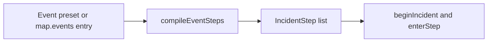

# Trip events from composed incident presets

## Goal

Authors should be able to place variations of a traffic jam, a blown tire, and the other current incidents by editing data, the way they compose a site from a preset. The van’s behavior stays on the existing incident step engine (`slow`, `window`, `fund`, `wait`, `tow`).

An **event** is the authored definition on the map. An **incident** remains the one running instance (queue, blocker, steps). That split avoids renaming the engine in [packages/plugin-road-trip/trip/incidents.ts](packages/plugin-road-trip/trip/incidents.ts).

## Stack and conventions

- Event schema, presets, and the compiler live in `@repo/road-trip-map`, beside sites ([ADR 0207](docs/adrs/0207-trip-maps-portable-json.md)). The plugin only runs steps.
- Authoring stays in minutes ([ADR 0207](docs/adrs/0207-trip-maps-portable-json.md) decision 3). The compiler converts to milliseconds.
- Start copy and timed beats post as chat prose through the existing `narrate` effect ([ADR 0212](docs/adrs/0212-site-narrative-chat.md)). Operational signs stay signs: item hints, fund costs, tow, and the cleared sign (the event’s `clearedNarrative`, or back on the road).
- Incident copy lives in data, not the engine. Cleared copy is on the event; immunity and item-resolved copy are on the part and consumable specs.
- Events stay server-only until they happen, same as `scriptedEvents` today. Players see the icon on the sign and the strip, not the definition ahead of time.
- New ADR **0220** (partially supersedes [0205](docs/adrs/0205-road-trips-v1.md) decision 12’s closed catalog and [0207](docs/adrs/0207-trip-maps-portable-json.md)’s `scriptedEvents` shape). `schemaVersion` stays `1`. `parseTripMap` lifts old `{ id, atMile, incident }` into the new shape, same approach as the physical-media carry lift. Trips have not shipped.

## Assumptions

- **Duration.** `durationMinutes` is only the length of a `slow` effect. A `stop` lasts until its resolution chain finishes, so it has no top-level duration. An item window’s length is `windowMinutes` on that resolution entry (blown tire’s 60s).
- **Beats** are minutes after the incident actually starts, not after it was queued, and not miles. Unfired beats are cancelled when the incident clears, including an early item resolve.
- **Families** keep part behavior attached to variations: `jam`, `flat`, `engine`, or `none`. Fuel is not a family; it is the `fuel` trigger plus a `refuel` resolution entry, so the tank refill is decided in one place.
- **Pre-emption** is by step kind, not family. An empty tank cuts short any active incident whose current step is `slow`.
- Host Quick Access stays the three static preset buttons in [packages/plugin-road-trip/schema.ts](packages/plugin-road-trip/schema.ts). Those buttons fire the built-in presets at the current mile. A custom variation fires because it is placed at a mile. Out of Gas still cannot be triggered by the host.
- Players see `icon`. `imageUrl` is authored and previewed in Game Studio, and linted like a site image. It is not sent to the room in this version.

## In scope

- `map.events[]` replaces `scriptedEvents` as the authored list, with a parser lift so existing JSON still loads.
- Four presets whose compiled steps match today’s `incidentSteps` switch in [packages/road-trip-map/src/incidents.ts](packages/road-trip-map/src/incidents.ts), including horn, Road-Grip immunity, AAA, tow-or-shoulder, fuel-truck refill, and out-of-gas pre-empting a jam.
- Optional chat narrative at start, plus optional timed narratives until the incident clears.
- Game Studio: add an event from a preset, edit it in an inspector, drag its mile, keep the cost estimate.

## Non-goals

- New effect or resolution kinds. A variation is parameters and copy on the kinds below.
- More than one incident at a time, or a different tow/fund/queue policy.
- Host buttons for custom events (the action form is static).
- GLB models on events, or showing `imageUrl` in the room.
- Bumping `schemaVersion`.

## Architecture

Identity fields, matching a site: `id`, optional `presetId`, `name`, `icon`, optional `imageUrl`, optional `narrative` and `narrativeVariant` (2000 chars, same prose rules as sites), optional `clearedNarrative` (500 chars, the cleared sign body; blank falls back to `BACK_ON_THE_ROAD`).

Placement: `trigger` is `mile` (the default) or `fuel`. Host triggering is not an authored option: Quick Access fires the three built-in presets through `triggerIncident`, and no map row can opt into it.

- `mile` arms the existing `scripted:<id>` threshold at the event’s `mile`. A tow that passes it marks it fired and does not start it.
- `fuel` is at most one event. Empty tank runs that override, or the built-in Out of Gas preset when the map has none. `fuel` with a `mile` is a lint error.

`family` selects part behavior:

- `jam`: horn replaces the slow factor and scales duration, as `compileVan` does today. CB Radio ends the slow step.
- `flat`: Road-Grip tires shrug it off, showing the part’s `immuneCopy`. Fix-a-Flat ends the item window.
- `engine`: no part immunity. AAA still covers a waivable fee.
- `none`: no part coupling unless a resolution entry names item short ids.

`effect`, optional:

- `{ kind: "slow", factor }` plus required `durationMinutes`.
- `{ kind: "stop" }`. The van is held for the whole chain.
- Omitted: post the narrative and any beats, do not block the van, and do not enter the incident queue. A tow past its mile still marks it fired.

`resolution`, an ordered chain of at most 8, compiled when the incident starts (mechanic ahead and installed parts are known then):

- `item` — on a slow effect, those items end it early (CB Radio). On a stop, it is today’s `window` step, then the rest of the chain. Default items come from the family.
- `fund` — today’s fund step: `purpose` (`roadside`, `tow`, `repair`, `delivery`), `baseCost`, `provider`, `waivable`. Defaults from `INCIDENT_COSTS`.
- `wait` — hold for `minutes`, with optional `label` and `status` (the “Refuelling” headline).
- `tow` — one smart entry that expands to today’s engine-failure branch: tow fund, wait, tow to `nearestMechanicAhead`, repair fund, repair wait; or shoulder repair when no mechanic is ahead. Costs and waits are overridable. It does not become a freeform step list the author has to write twice.
- `refuel` — expands to the delivery fund (`deliveryBaseCost`) plus the refuel wait. It is the only thing that fills the tank: clearing an incident that compiled a `refuel` entry fills the tank and the gauge climbs during the wait. This replaces the `incident === "out-of-gas"` checks in `pendingRefill`, `finishIncident`, `projection.ts`’s fuel warning, and `describeEvent`’s “Refuelled” line.

`beats`: up to 8 `{ atMinutes, narrative, narrativeVariant? }`. Armed as thresholds when the incident begins; cancelled in `finishIncident`.

Preset defaults, so current behavior falls out of the compiler rather than the switch:

- Traffic jam: family `jam`, slow 0.4 for 8 minutes, item `cb-radio`, narrative “Hit some traffic. The van crawls along.”, `clearedNarrative` “Traffic clears”.
- Blown tire: family `flat`, stop, item `fix-a-flat` for 1 minute, roadside fund 40 waivable, wait 1.5 minutes “Changing the tire”.
- Engine failure: family `engine`, stop, one `tow` entry with today’s costs and waits.
- Out of gas: family `none`, trigger `fuel`, stop, one `refuel` entry, `clearedNarrative` “Fuel’s in”.

`incidentSteps(map, incidentId, ctx)` becomes a wrapper that compiles the matching preset, so Game Studio cost estimates and existing tests keep a single entry. New `compileEventSteps(map, event, ctx)` is what the plugin calls for a map event.

Part catalog keys change from incident ids to families: `immuneTo: ["flat"]`, consumable `resolves: "jam" | "flat"`. AAA stays “next waivable fee”, not family-specific. Parts with `immuneTo` gain `immuneCopy: { title, body }` (Road-Grip: “Road-Grip tires to the rescue”). Consumables gain `resolvedCopy: { title, body }`, where the engine prefixes the user’s name to `title` (CB Radio: “found a way around”; Fix-a-Flat: “patched the tire”). The hardcoded strings in [packages/plugin-road-trip/trip/incidents.ts](packages/plugin-road-trip/trip/incidents.ts) move there.

Runtime snapshot: `QueuedIncident` and `ActiveIncident` store the event id plus `name`, `icon`, `family`, `clearedNarrative`, and `refuels` (whether the chain has a `refuel` entry), taken at start. Host presets are not map rows, so the runner cannot look them up on `map.events` later. Log lines gain `name` and `icon`; `describeEvent` uses those instead of `INCIDENTS[id]`. Built-in runs keep the ids `traffic-jam`, `blown-tire`, `engine-failure`, and `out-of-gas`.

Start presentation: prose `narrative` when non-blank, plus the operational sign (title = name, icon = icon, body = the item or fund hint only). Today’s story sentence moves from the sign body into chat. The cleared sign uses the snapshot’s `clearedNarrative`, otherwise `BACK_ON_THE_ROAD`; the per-incident branches in `finishIncident` go away.

Client store: `TripStoreLive` incident and `TripStoreIncident` carry `icon` and stop using `IncidentId` as a catalog key. [apps/web/src/components/PluginComponents/templates/roadTrip/tripView.ts](apps/web/src/components/PluginComponents/templates/roadTrip/tripView.ts) reads `icon` from the store instead of `INCIDENTS[live.incident]`.

Lint, updated from [packages/road-trip-map/src/lint.ts](packages/road-trip-map/src/lint.ts): duplicate id, mile at or past the destination, `tow` with no mechanic ahead (`no-mechanic`), more than one `fuel` trigger, `fuel` with a mile, a `mile` trigger with no mile, `slow` without a duration, `stop` with an empty resolution chain, beat at or before 0.

## Implementation phases

### 1. ADR, schema, presets, compiler

Write [docs/adrs/0220-trip-events.md](docs/adrs/0220-trip-events.md) and index row. Add the event Zod objects to [packages/road-trip-map/src/schema.ts](packages/road-trip-map/src/schema.ts), presets, and `compileEventSteps` next to the current step types in [packages/road-trip-map/src/incidents.ts](packages/road-trip-map/src/incidents.ts). Lift `scriptedEvents` inside [packages/road-trip-map/src/parseTripMap.ts](packages/road-trip-map/src/parseTripMap.ts). Point lint and `incidentCostEstimate` at the compiler. Add `immuneCopy` and `resolvedCopy` to the part and consumable specs in [packages/road-trip-map/src/van.ts](packages/road-trip-map/src/van.ts). Update the sample map.

**Done means:** a parity test captures today’s `incidentSteps` output before the switch is removed, then asserts that `compileEventSteps` on each preset deep-equals it for every built-in × a spread of miles (mechanic ahead, none ahead) × parts combination (none, horn, Road-Grip, AAA, all). This covers immunity, horn, tow vs shoulder, and delivery cost beyond the existing cases in [packages/road-trip-map/src/van.test.ts](packages/road-trip-map/src/van.test.ts). Old scripted-event JSON still parses. New lint codes fail the cases above.

**Depends on:** none.

### 2. Run authored events

In [packages/plugin-road-trip/trip/incidents.ts](packages/plugin-road-trip/trip/incidents.ts) and [packages/plugin-road-trip/trip/state.ts](packages/plugin-road-trip/trip/state.ts), start from a compiled event instead of `INCIDENTS[id]`. Thread family through queue, immunity, and item use ([packages/plugin-road-trip/items/index.ts](packages/plugin-road-trip/items/index.ts)). Pre-emption checks the active step kind (`slow`) instead of `traffic-jam`. Refill and the fuel warning read the snapshot’s `refuels`. Immunity, item-resolved, and cleared signs read their copy from the part, consumable, and snapshot. Post `narrative` and schedule beats; cancel beats on clear. `triggerIncident("traffic-jam" | "blown-tire" | "engine-failure")` still compiles that preset. `describeEvent` and the markdown export use stored name and icon.

**Done means:** [packages/plugin-road-trip/trip/trip.test.ts](packages/plugin-road-trip/trip/trip.test.ts) and [packages/plugin-road-trip/index.test.ts](packages/plugin-road-trip/index.test.ts) incident cases stay green: jam, CB Radio, horn, flat window, Fix-a-Flat, Road-Grip, engine tow and shoulder, AAA, out-of-gas pre-empt and refill, queue while parked, tow skips a scripted mile. New tests cover:

- A custom jam (different factor, duration, and a beat that does not fire after an early resolve).
- A custom `none`-family slow event that an empty tank pre-empts.
- A custom `flat` event that Road-Grip shrugs off with the part’s `immuneCopy`.
- A narrative-only event that does not stop the van.
- Beats never fire after host skip-to-end.

**Depends on:** phase 1.

### 3. Client projection

Add `icon` to the live incident and van-sheet incident in [packages/plugin-road-trip/trip/projection.ts](packages/plugin-road-trip/trip/projection.ts) and [packages/road-trip-map/src/storeTypes.ts](packages/road-trip-map/src/storeTypes.ts). Update `stripContext` and `stripReadout` to use it. Studio-bridge fixtures that build a `TripStore` incident get the same field.

**Done means:** `tripView` tests pass without reading `INCIDENTS` for the strip. A custom icon in the store is what the strip shows.

**Depends on:** phase 2.

### 4. Game Studio authoring

Replace the scripted-incident picker in [apps/game-studio/src/components/tripMap/TripMapEditor.tsx](apps/game-studio/src/components/tripMap/TripMapEditor.tsx) with preset buttons plus an inspector modeled on [apps/game-studio/src/components/tripMap/TripSiteInspector.tsx](apps/game-studio/src/components/tripMap/TripSiteInspector.tsx): name, icon, image, narrative, variant, mile, effect, duration, resolution chain, beats, and the existing cost estimate. [apps/game-studio/src/components/tripMap/TripRouteTrack.tsx](apps/game-studio/src/components/tripMap/TripRouteTrack.tsx) pins use `event.icon` and `event.mile`. Draft helpers in [apps/game-studio/src/tripMap/tripMapDraft.ts](apps/game-studio/src/tripMap/tripMapDraft.ts) stamp `eventFromPreset`. Simulator labels in [apps/game-studio/src/tripSim/describeTripSim.ts](apps/game-studio/src/tripSim/describeTripSim.ts) use the event’s name and icon. Host buttons in the sim stay the three presets.

**Done means:** stamping each preset, changing a jam’s factor and a beat, and Copy JSON round-trips through `parseTripMap`. The route pin shows the custom icon. Cost estimate for an engine failure still matches tow vs shoulder.

**Depends on:** phase 1. Can follow phase 2 in parallel with phase 3.

### 5. Docs

Update the incident sections of [docs/PLUGIN_DEVELOPMENT.md](docs/PLUGIN_DEVELOPMENT.md) and [AGENTS.md](AGENTS.md) to describe `map.events`, presets, families, and where incident copy now lives.

**Done means:** neither doc names the closed incident catalog or `scriptedEvents` as current.

**Depends on:** phases 1–2.

## Risks and tradeoffs

- The smart `tow` and `refuel` kinds hide a branch inside one resolution entry. Authors tune costs and waits on that entry; they do not hand-write the shoulder alternative. Rejected alternative: a raw step-list editor, which can express illegal sequences and duplicates the engine.
- Moving the story sentence from the sign into chat changes presentation, which is the requested narrative. The operational hint stays on the sign so “Got a Fix-a-Flat?” is not lost.
- Family tags mean a custom event opts into horn or Road-Grip only by setting `family`. A `none` event with a slow effect will not be shortened by the horn. Rejected alternative: multi-valued tags, which raise precedence questions (an event tagged both tire and traffic) that no current item needs. Widening `family` to a list later is a cheap parse lift.
- Dropping the `fuel` family means a custom event can fill the tank only through a `refuel` entry. That is the intent: one source of truth for refills.
- Beats use the same threshold arming as incident steps. A long beat list is capped at 8 so a map cannot arm an unbounded set.

## Open questions

None. Host-triggerable custom events and in-room artwork are intentionally deferred.
