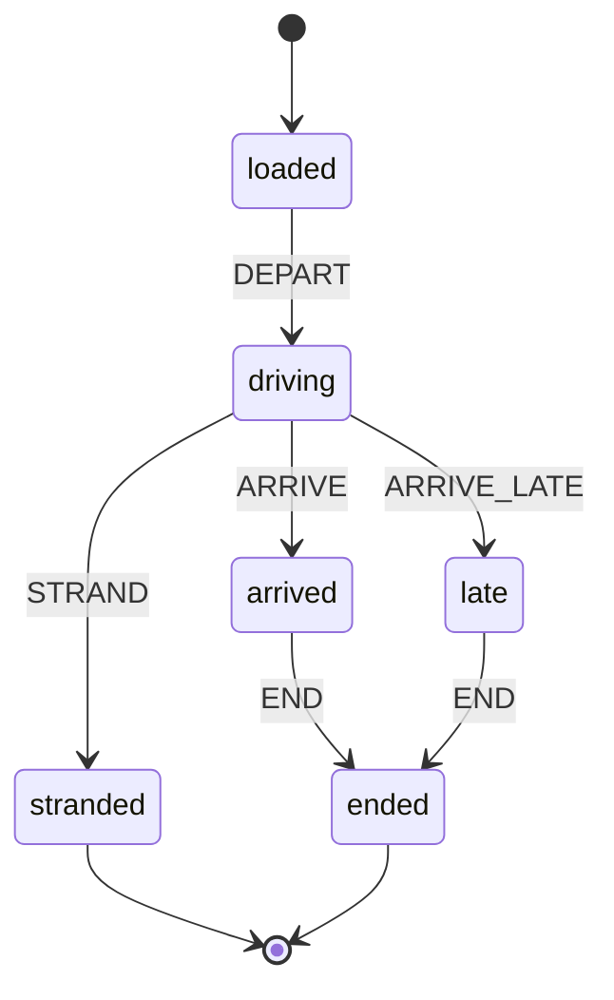
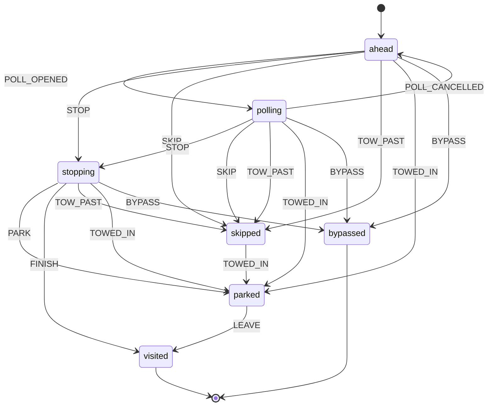
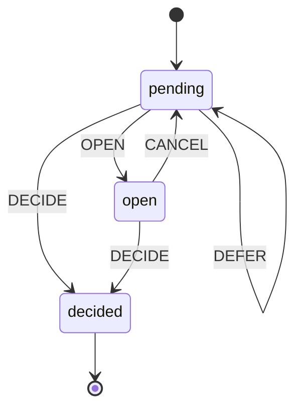
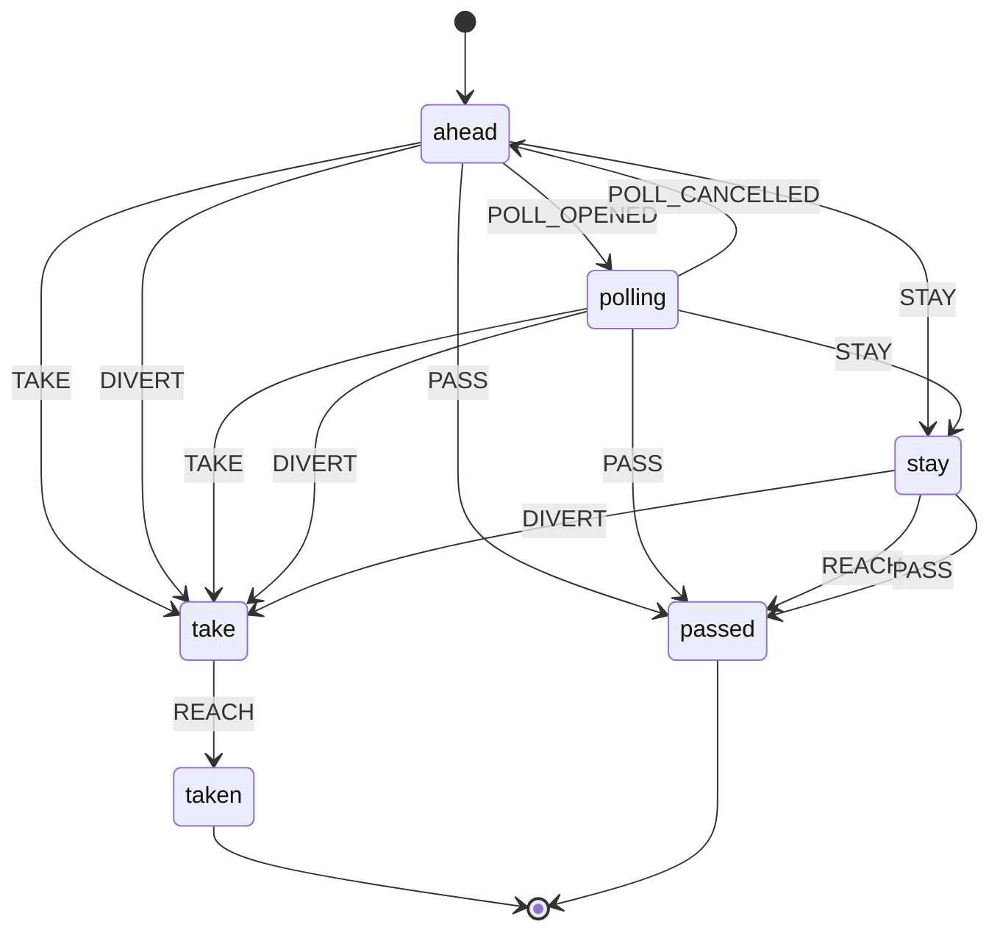
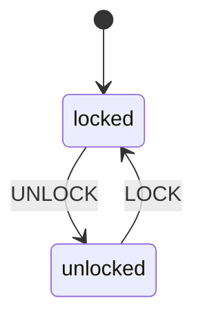

<!-- Generated by `npm run flow:docs` in packages/plugin-road-trip. Do not edit by hand. -->

# Road trip flow

A trip is one statechart built from small flat machines ([ADR 0222](adrs/0222-trip-flow-and-branches.md)):
the trip lifecycle runs beside one machine per site, junction (fork), layer, and vote. Every
threshold, poll close, item use, outcome, and host action becomes a flow event; `dispatch`
routes it to the entity below, which runs `interpret` (conditions) → the table (legal moves)
→ `onEnter` (effects).

Ownership rules (enforced by `trip/flow/architecture.test.ts`):

1. Only `dispatch` changes a machine: nothing outside `trip/flow/entities/` writes a phase or the trip status.
2. Only `trip/flow/outcomes.ts` interprets outcomes (`unlock`, `lock`, `divert`).
3. Only `road-trip-map/src/paths.ts` reads authored miles: runtime code reads the path map
   (`ctx.map`, `pathFor(...)`), where sites and events sit at odometer miles.

## Flow events

| Event | Handled by | Meaning |
|---|---|---|
| `TRIP_DEPART` | trip machine | Host departs. |
| `TRIP_ARRIVE` | trip machine | The destination site finished arriving; the trip arrives (late after the deadline). |
| `TRIP_END` | trip machine | Host ends the trip (stranded while driving). |
| `SITE_REVEAL` | site machine | A reveal threshold or a Trip Guide names a site (data only, no move). |
| `SITE_ARRIVE` | site machine | The van reaches a site: an undecided exit's vote closes first, then it parks or passes. |
| `SITE_POLL` | site machine | The site's vote opened or closed undecided. |
| `SITE_LEAVE` | site machine | A stop ends (park timer, trip end, the Mechanic's incident clears). |
| `SITE_DECIDE` | site machine | The exit vote's winner: stop or skip. |
| `SITE_BYPASS` | site machine | A rejoin skipped it, or its layer unlocked after the van passed. |
| `SITE_TOW_PAST` | site machine | A tow carries the van past it. |
| `SITE_TOWED_IN` | site machine | A tow arrives at this Mechanic. |
| `JUNCTION_REACH` | junction machine | The van reaches a fork: an undecided vote closes first, then it turns or passes. |
| `JUNCTION_POLL` | junction machine | The junction's vote opened or closed undecided. |
| `JUNCTION_DECIDE` | junction machine | The junction vote's winner: take or stay. |
| `JUNCTION_TOW_SETTLE` | junction machine | A tow is about to pass this fork: an open vote resolves, an unpolled fork passes. |
| `DIVERT` | junction machine | A divert outcome takes a fork ahead. |
| `ROUTE_END` | handler | The van reaches the end of a rejoining route; it continues on the target route. |
| `LAYER_UNLOCK` | layer machine | An unlock outcome or Local Map; content behind the van is missed. |
| `LAYER_LOCK` | layer machine | A lock outcome; open votes on its content cancel, commitments carry on. |
| `VOTE_OPENED` | vote machine | The plugin opened the room poll. |
| `VOTE_DEFERRED` | vote machine | Another poll holds the room; retry later. |
| `VOTE_CLOSED` | vote machine | The vote closes with a tally, or with no poll (the default wins). |
| `VOTE_CANCEL` | vote machine | The poll closes without a decision. |
| `CHOICE_DECIDED` | handler | An event choice's winner: its outcomes and narrative apply, then the step advances. |
| `APPLY_OUTCOMES` | handler | Expanded by outcomes.ts into LAYER_UNLOCK, LAYER_LOCK, and DIVERT. |

## Trip

| State | Meaning |
|---|---|
| `loaded` | Map loaded; the van waits for the host. |
| `driving` | On the road (pauses, stops, and incidents are blockers, not phases). |
| `arrived` | Reached the destination on time. |
| `late` | Reached the destination after the deadline. |
| `stranded` (final) | The host ended the trip before the destination. |
| `ended` (final) | The host closed out an arrived trip. |

| Move | When |
|---|---|
| `loaded` → `driving` on `DEPART` | Host departs. |
| `driving` → `arrived` on `ARRIVE` | The van reaches the destination before the deadline. |
| `driving` → `late` on `ARRIVE_LATE` | The van reaches the destination after the deadline. |
| `driving` → `stranded` on `STRAND` | Host ends the trip while driving. |
| `arrived` → `ended` on `END` | Host ends an arrived trip. |
| `late` → `ended` on `END` | Host ends an arrived trip. |

## Site

| State | Meaning |
|---|---|
| `ahead` | Optional site awaiting its exit vote. |
| `polling` | Exit vote open. |
| `stopping` | Will park on arrival (mandatory, or the room chose to stop). |
| `parked` | The van is parked here. |
| `visited` (final) | Stopped here (or arrived, for the destination). |
| `skipped` | Driven or towed past. A tow can still bring the van in to a skipped Mechanic. |
| `bypassed` (final) | Off the van's path for good. |

| Move | When |
|---|---|
| `ahead` → `polling` on `POLL_OPENED` | The exit vote opened. |
| `ahead` → `stopping` on `STOP` | Decided: pull off. |
| `ahead` → `skipped` on `SKIP` | Decided: keep driving. |
| `ahead` → `skipped` on `TOW_PAST` | A tow carries the van past it. |
| `ahead` → `parked` on `TOWED_IN` | A tow arrives here (a Mechanic). |
| `ahead` → `bypassed` on `BYPASS` | A route bypasses it, or its layer unlocked after the van passed. |
| `polling` → `ahead` on `POLL_CANCELLED` | The exit vote closed undecided (trip ended, tow, layer locked). |
| `polling` → `stopping` on `STOP` | Decided: pull off. |
| `polling` → `skipped` on `SKIP` | Decided: keep driving. |
| `polling` → `skipped` on `TOW_PAST` | A tow carries the van past it. |
| `polling` → `parked` on `TOWED_IN` | A tow arrives here (a Mechanic). |
| `polling` → `bypassed` on `BYPASS` | A route bypasses it, or its layer unlocked after the van passed. |
| `stopping` → `parked` on `PARK` | The van arrives and parks. |
| `stopping` → `visited` on `FINISH` | The van arrives at the destination. |
| `stopping` → `skipped` on `TOW_PAST` | A tow carries the van past it. |
| `stopping` → `parked` on `TOWED_IN` | A tow arrives here (a Mechanic). |
| `stopping` → `bypassed` on `BYPASS` | A route bypasses it, or its layer unlocked after the van passed. |
| `parked` → `visited` on `LEAVE` | The stop ends. |
| `skipped` → `parked` on `TOWED_IN` | A tow arrives here (a Mechanic). |

## Vote

| State | Meaning |
|---|---|
| `pending` | Not open yet (waiting for its lead, or retrying after a 409). |
| `open` | A room poll is open. |
| `decided` (final) | A winner was applied (tally, tie, or default). |

| Move | When |
|---|---|
| `pending` → `open` on `OPEN` | The room poll opened. |
| `pending` → `pending` on `DEFER` | Another poll holds the room; retry later. |
| `pending` → `decided` on `DECIDE` | Closed with a winner (or no poll could run: the default wins). |
| `open` → `pending` on `CANCEL` | Closed without a decision. |
| `open` → `decided` on `DECIDE` | Closed with a winner (or no poll could run: the default wins). |

## Junction

| State | Meaning |
|---|---|
| `ahead` | Fork ahead, undecided (paths treat it as stay). |
| `polling` | Junction vote open. |
| `take` | Decided: turn onto the route at the fork. |
| `stay` | Decided: stay. |
| `taken` (final) | The van turned onto the route. |
| `passed` (final) | The van went past the fork. |

| Move | When |
|---|---|
| `ahead` → `polling` on `POLL_OPENED` | The junction vote opened. |
| `ahead` → `take` on `TAKE` | The vote chose the route. |
| `ahead` → `stay` on `STAY` | The vote chose to stay. |
| `ahead` → `take` on `DIVERT` | A divert outcome takes the route. |
| `ahead` → `passed` on `PASS` | Passed undecided (a tow, or the fork was never polled). |
| `polling` → `ahead` on `POLL_CANCELLED` | The vote closed undecided (the fork's layer locked). |
| `polling` → `take` on `TAKE` | The vote chose the route. |
| `polling` → `stay` on `STAY` | The vote chose to stay. |
| `polling` → `take` on `DIVERT` | A divert outcome takes the route. |
| `polling` → `passed` on `PASS` | Passed undecided (a tow, or the fork was never polled). |
| `take` → `taken` on `REACH` | The van reaches the fork. |
| `stay` → `passed` on `REACH` | The van reaches the fork. |
| `stay` → `take` on `DIVERT` | A divert outcome takes the route. |
| `stay` → `passed` on `PASS` | Passed undecided (a tow, or the fork was never polled). |

## Layer

| State | Meaning |
|---|---|
| `locked` | Its sites and events are inert. |
| `unlocked` | Its content ahead of the van is live. |

| Move | When |
|---|---|
| `locked` → `unlocked` on `UNLOCK` | An unlock outcome (site visit, event, choice, Local Map). |
| `unlocked` → `locked` on `LOCK` | A lock outcome. |
